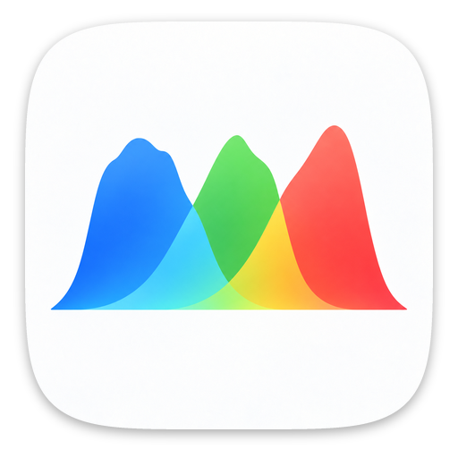
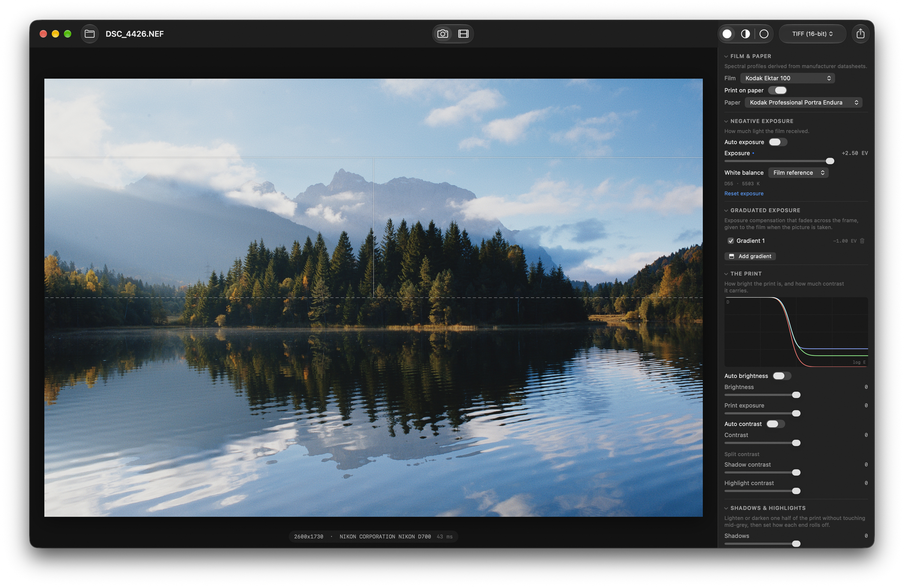
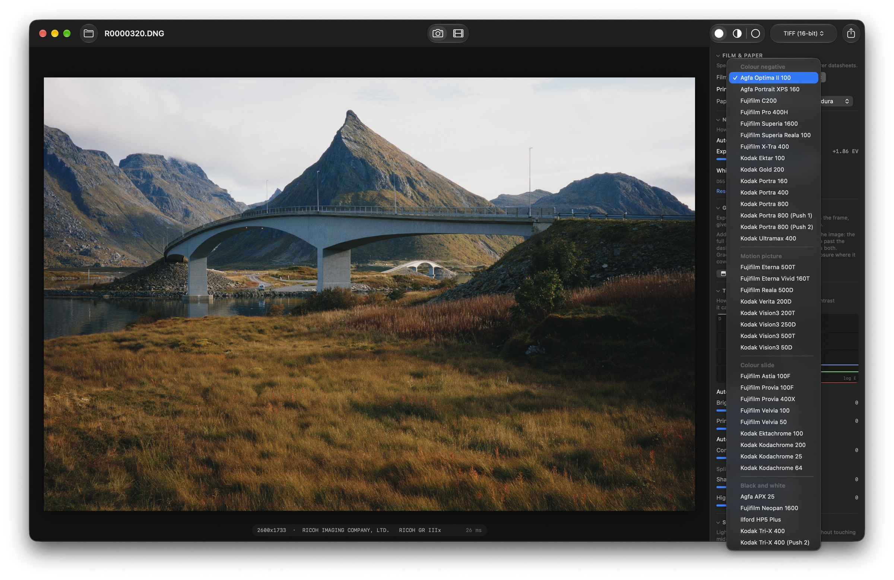

# FLX Film Lab

FLX Film Lab is a Mac app for shooting digital photos as if they were film.

**Its films are physical models, not presets.** Each of its 34 stocks, whether
colour negative, slide, cinema or black and white, is modelled from its
manufacturer's datasheet. That means the spectral sensitivity of each layer, its
characteristic curves and the dyes it forms, with the development couplers that
shape its colour. The light in your RAW file exposes that virtual film, which is
then developed and printed onto paper, or viewed as a slide on a light table.

**Around them sits a hybrid workflow, half digital camera and half darkroom.**
- **Before the negative:** exposure correction, white balance set by the film,
  auto exposure that keeps the stock's highlights, graduated filters, and
  Wratten filters for black and white.
- **After it:** paper grades and split grade, tone and colour controls, and
  dodge and burn.
- **Beyond stills:** the same looks grade log video, and bake into LUTs for a
  Lumix camera's Real Time LUT or an iPhone camera app.



It is a native SwiftUI + Metal app. There is no Python at runtime, no LibRaw, no
bundled interpreter: it opens RAW files from any camera macOS supports through
macOS's own RAW pipeline and runs the whole film model on the GPU.

- **The physics** is a port of [agx-emulsion / spektrafilm][agx] — real spectral
  sensitivities, characteristic curves and dye absorption spectra read off
  manufacturer datasheets, plus DIR couplers, halation and a stochastic grain
  model. FLX Film Lab ships with 34 film stocks and 9 print stocks, among them
  four black-and-white films and a black-and-white paper. Its slide stocks are
  read directly off a virtual light table rather than printed, since printing a
  positive onto RA-4 paper inverts it — and the scan is white-balanced on the
  film base, the way a projector or a scanner treats clear film, without which
  a slide's whites top out around 79% and the whole frame reads flat.
- **The controls** follow [NegPy][negpy]'s darkroom ergonomics — ISO-R grade,
  split grade, separate shadow and highlight density, independent toe and
  shoulder, regional colour timing, and masked dodge & burn where each mask
  carries its own contrast filter.

Both are GPLv3; so is this. See `NOTICE.md` for attribution and for the list of
places where this deliberately departs from either reference.



## Built on spektrafilm, and what is new here

spektrafilm is the foundation. Its physical model of exposure, development,
printing and scanning, and most of its film data, are what everything here
stands on. Its author describes it as a reference implementation, the place
where the model grows, with a Python desktop GUI for exploring it. FLX Film Lab
sets out to be something else: a tool to photograph and grade with. Getting
there meant a native port of the whole model, a film library nearly twice the
size, rebuilt slide films, a capture and darkroom workflow of its own, and a
video mode. That is where most of the work in this repository went.

### What it uses

- **spektrafilm's model.** This covers spectral upsampling of the scene, each
  film's spectral sensitivities and characteristic curves, development with DIR
  couplers, the dichroic colour enlarger, the print and the scan, in-emulsion
  scatter and halation, and the stochastic grain model. It is ported to Metal
  function by function and held to the original: film exposure and negative
  density match bit for bit, the final colour to within 6e-4 (`tests/parity`).
- **spektrafilm's data.** 14 of the 34 film stocks are spektrafilm's, used as they
  are: Kodak Portra 160, 400 and 800 (and Portra 800's two pushes), Ektar 100, Gold
  200, Ultramax 400, the four Vision3 stocks, Verita 200D, and Fujifilm C200,
  Pro 400H and X-TRA 400. So are all eight of its print stocks. The colour
  profiles built here take from its sister stocks what a datasheet does not give,
  such as base densities and coupler matrices; `NOTICE.md` lists it stock by
  stock.
- **NegPy's design.** The darkroom controls, the print meters, and the glow
  and halation effects follow NegPy; no NegPy code is used.

### What is new

- **A native app.** The model runs on the GPU. A slider move re-renders the
  2048-pixel preview in about 14 to 30 ms, and a 45-megapixel NEF renders at
  full resolution in under a second on an M4 Pro. RAW files decode through macOS
  itself, and nothing in the app needs Python.
- **Camera-side controls, before the negative.** spektrafilm's controls are
  mostly the model's own parameters: coupler and channel switches, curve gamma
  factors, spectral upsampling options. That suits a reference. FLX Film Lab puts
  a camera in front of the negative instead:
  - **Exposure** moves the scene along the film's curve with the print time held
    fixed, so over- and under-exposure look the way they do on film. spektrafilm
    re-times the enlarger by default, which hides the change.
  - **Auto exposure** places the scene within the stock's own highlight
    headroom, rather than metering the frame to mid-grey.
  - **White balance** defaults to the light the film is balanced for, so daylight
    film under tungsten goes orange.
  - **Graduated exposure** stacks plus-or-minus gradients on the negative, like
    grad filters on the lens.
  - **Kodak Wratten filters** come with their filter factors for black and white.
- **A darkroom, after the negative.** This follows NegPy's design:
  - contrast as an ISO-R paper grade, with split grade;
  - brightness, shadows, highlights, blacks and whites on the print's lightness,
    plus toe and shoulder;
  - colour timing through the enlarger's filters, and in the shadows and
    highlights separately;
  - pre-flash;
  - dodge and burn with polygon, oval and gradient masks, each with its own
    contrast;
  - print meters that read the frame the way a printer reads a negative;
  - slides viewed on a light table and white-balanced on the film base.

  spektrafilm's print side offers print exposure, the yellow and magenta
  filters, pre-flash, auto-compensation, and gamma factors that reshape the
  paper's curve, overall, per channel and per sub-layer.
- **18 more stocks, each from its own datasheet.**
  - 16 film stocks spektrafilm does not have: Fujifilm Astia 100F, Provia
    400X, Velvia 50, Superia 1600, Superia Reala 100, Eterna Vivid 160T,
    Eterna 500T, Reala 500D and Neopan 1600; Kodak Kodachrome 25 and 200 and
    Tri-X 400; Agfa Optima II 100, Portrait XPS 160 and APX 25; and Ilford HP5
    Plus.
  - Tri-X pushed two stops, and Ilford Multigrade paper.

  Each profile's characteristic curves and spectral sensitivities, and, where
  the sheet plots them, its dye spectra and MTF curves, are read off the sheet's
  own plots (`tools/bake`).
- **Slide films, rebuilt.** All nine slide films come from their own sheets.
  That includes the four spektrafilm has, Provia 100F, Velvia 100, Ektachrome
  E100 and Kodachrome 64, whose profiles here replace its own.
  - **Colour:** spektrafilm sets coupler strength by eye. Here each slide's
    colour is checked against what its sheet says about it next to its sister
    stocks, and set from it where they disagreed.
  - **Sharpness:** each slide is fitted to its sheet's MTF curve. That took two
    engine changes, a share of the inhibitor that diffuses and a cap on its edge
    gain, and a grid sixteen times finer for inverting the couplers.
- **Black and white.** spektrafilm's main line is colour only; its
  black-and-white work sits on an unmerged branch. Here four black-and-white
  films and a silver paper are built from datasheets alone, as noted above. They
  run neutral through the three-layer engine, with grain and sharpness from
  Kodak's and Agfa's published data.
- **Video.** The Motion mode grades log footage through the same engine as
  photographs, live while it plays, and exports the graded clip. Output is
  ProRes 422 HQ or 10-bit HEVC, with audio and metadata kept, encoded so that
  QuickTime, Photos and Safari show what the preview shows.
  - It reads N-Log, V-Log, Apple Log and Apple Log 2, F-Log and F-Log2, Canon
    Log 2 and 3, and S-Log3, and tells the format from the file or the camera.
  - It meters each clip for slide film, and adds bloom, glow and halation
    on the print.

  spektrafilm has no video mode.
- **LUTs of the app's own look.** spektrafilm has a capable LUT creator of its
  own, with more log inputs and LUT formats: ARRI, RED and DJI log, HDR, `.3dl`,
  Hald images and OCIO configs.
  - `flxlut` and Export LUT… bake the look exactly as it is set in the app,
    print grade, split grade and filters included, from the same engine as the
    preview.
  - They cover every format the Motion mode reads, Apple Log 2 and Canon Log 2
    among them.
  - The output is ready for a Lumix camera's Real Time LUT and for iPhone camera
    apps, and the baker is checked against the engine (`lutchecks`).
- **Checked as it goes.** Besides the parity harness, invariant checks cover
  what parity cannot see. Separate suites cover the app, the LUT baker and the
  video path (*Verification*).

## Download

Each release comes as a disk image: open it and drag FLX Film Lab to
Applications. The app is not signed with a paid Apple developer certificate, so
macOS refuses the first launch, calling it damaged or from an unidentified
developer. Run this once in Terminal, then open it normally:

```bash
xattr -cr "/Applications/FLX Film Lab.app"
```

It needs macOS 14 or later. The app is universal, for Apple Silicon and Intel,
but has only been tried on Apple Silicon.

Releases also carry a V-Log LUT pack, `FLX-Film-Lab-V-Log-LUTs-<version>.zip`,
for a Lumix camera's Real Time LUT: every film stock on its usual paper,
slides on a light table, and Tri-X through its five camera filters, to load
onto the camera and shoot without the app. Its read-me says how.

## Build and run

Needs macOS 14+ and the Command Line Tools. **Xcode is not required** — there is no `.xcodeproj`, and Metal shaders are compiled at runtime
from `FLXFilmLab/Resources/Shaders/flx.metal`.

```bash
./build.sh run
```

That produces **`FLX Film Lab.app` in this folder** and launches it — double-click
it there, or drag it to /Applications. `./build.sh install` copies it there for
you. It has two modes, switched in the middle of the toolbar or with ⌘1 and
⌘2: **Stills**, for a RAW photograph, and **Motion**, for a log video clip
(see Motion mode below). Each keeps its own file open while the other is in
front, and a file opened from Finder goes to the mode that reads it. In
Stills, drop a RAW on the window, or use Open. Export writes a 16-bit TIFF, a JPEG
or a PNG with the output profile embedded, and carries the photograph's
metadata over from the source — when it was taken, the camera, the lens, the
exposure, where — for NEF, DNG and any other file macOS can read.

Other targets:

```bash
./build.sh parity
./build.sh checks
./build.sh apptest
```

The first runs the numeric parity harness against reference renders from the
real Python pipeline; the second checks the app's own defaults, which parity
cannot reach (see Verification below); the third drives the document model
through opening, editing and switching images, on generated test files.

The tools and the test suites build against one module of the shared code,
compiled once into `build/core` and again only when one of its sources
changes, so after the first each builds in seconds. `UNIVERSAL=0 ./build.sh`
builds the app for Apple Silicon only, in half the time.

With only the Command Line Tools installed, `build.sh` compiles against the
newest SDK whose SwiftUI does not need Xcode's macro plugin (the macOS 27 SDK
does), and says so when it falls back.

## The pipeline

Scene light in, print out. Each stage names its origin in the shader source.

| Stage | What happens |
|---|---|
| RAW decode | `CIRAWFilter`, scene-referred and linear — no tone curve, no highlight boost, no gamut mapping, and none of the "shadow bias" Apple otherwise subtracts to hide noise (3.0 on Nikon Z, 5.0 on a Leica M), which put the darkest light the sensor recorded below zero, beyond any Exposure. No luminance noise reduction, so the film's grain is the texture; colour noise reduction and sharpening stay at Apple's defaults for the camera. White-balanced for the *film's* reference illuminant, not as-shot |
| Film exposure | RGB → XYZ (CAT16 to the stock's reference illuminant) → chromaticity → a baked 192×192 LUT that carries the whole spectral upsampling *and* the film's 81-band sensitivity projection |
| Scatter & halation | linear irradiance propagated through the emulsion and reflected off the base — the red bloom around bright edges |
| Development | characteristic curves plus DIR couplers: inhibitor released as density forms, diffused, then re-developed against the pre-coupler curves |
| Grain | Poisson–Binomial particle model per layer, loudest in the midtones, softened by agx's 0.65 px blur. Scale follows the film format — 35 mm or 120 — because that sets the pixel pitch, and the same emulsion on 120 is enlarged less. Measured here at 35% finer. Added as texture only: every region averages to the grain-free light, so a full-size export matches the preview |
| Enlarger | 81-band integral through the negative's dyes, a tungsten-halogen source and CMY dichroic filters, onto the paper's own sensitivities |
| Dodge & burn | per-pixel print-exposure and local-grade map |
| Paper | the paper's characteristic curve, reshaped by the tone controls |
| Scan | 81-band integral under the viewing illuminant → XYZ → output RGB, with gamut compression |

The last four are one fused Metal kernel, which is why the tone controls are
instant: a slider move re-runs only the per-pixel print stage, not the film.

## How shadows and highlights are controlled

This is the part the app is really for. Every control is exactly identity at its
default, so a slider at zero is provably doing nothing.

The sliders are named the way Capture One and Lightroom name them — Brightness,
Contrast, Shadows, Highlights, Blacks, Whites, Temperature, Tint — and positive
always means brighter. Underneath, each one drives a darkroom quantity, and the
tooltip always tells you which and shows its current physical value. Output →
**Control names → Darkroom** relabels everything to the underlying controls.

| Slider | What it really is |
|---|---|
| Brightness | a midtone move on the print's lightness: mid-grey moves most, paper black and white not at all |
| Print exposure | the enlarger timer, in stops — every tone moves, rolling into toe and shoulder instead of clipping |
| Contrast | the paper's contrast grade, as an ISO range value (R115 neutral) |
| Shadow / Highlight contrast | split grade: the hard-filter and soft-filter halves of a split-grade print |
| Shadows / Highlights | lightness moves confined to the dark or light half of the print |
| Blacks / Whites | the toe and shoulder — how each end of the scale rolls off |
| Blacks / Whites range | how far each roll-off reaches into the tonal scale |
| Midtone contrast | an anchor-preserving midtone gamma |
| Temperature / Tint | the enlarger's yellow and magenta dichroic filters |
| Highlight protection | paper pre-flash |

**Reset exposure**, **Reset tone**, **Reset colour** and **Reset film character**
each put their own section back to its defaults.

Brightness, Shadows and Highlights are defined on the print's *lightness* —
paper black to paper white, linear in L*, computed from the paper's own dyes —
rather than on density. Density is logarithmic: on an RA-4 paper the shadows
take up three quarters of it, so weights placed in density reached deep into
the midtones from one side and barely cleared paper white on the other, and at
full travel Highlights folded the curve back on itself. On lightness each
control keeps to its band: Brightness peaks at the paper's own mid-grey and
fades to nothing at either end; Shadows acts hardest in the deep shadows just
above black (around L* 15) and is gone just short of mid-grey; Highlights
mirrors it just below white. None of the three moves paper black or paper
white — Blacks and Whites do that — so a deep shadow can be lifted much further
than it can be darkened before it runs into black, and the same for highlights
the other way: ±100 means the most each direction can do smoothly.

The three are applied as one density change to all three dye layers at once,
looked up by their mean, rather than to each layer separately. The same curve
per layer lifts a skin tone's yellow and magenta (near mid-grey) far more than
its cyan (near white), which turned a face 15° toward yellow; moved together,
a tone gets lighter without changing hue, which is also what a print-exposure
change does. No setting, alone or combined, can reverse a tone: each band stops
short of where it could, and the curve's slope is floored for extreme
combinations.

The split-contrast and regional-colour zones use the same lightness scale, set
around where the paper prints an 18% grey.

**Colour crossover** exists because a dichroic filter can only shift a whole dye
layer in parallel — it cannot fix crossover, where shadows cast one colour and
highlights the complement. The per-layer trims can.

The inspector's curve plot is drawn from the same function that fills the LUT
the GPU reads, with the meters' choices filled in, so it cannot drift out of
step with the image.

## White balance

The decode is balanced for the illuminant the loaded **film** is balanced for —
D55 for a daylight stock, 2856 K for a tungsten one — not for the scene. D55 is
set as its chromaticity, not as "5503 K": Core Image reads a bare temperature as
a lamp of that colour, which is pinker than daylight, and every daylight frame
then decoded green-yellow.

That is the whole point. A daylight film shot under tungsten really does go
orange, and Vision3 500T in daylight really does go blue; that is the emulsion
reacting to light it was not designed for. Decoding "as shot" lets the camera
neutralise the illuminant before the film ever sees it, which quietly throws all
of that away and makes every stock behave as if the light were perfect. As shot,
Daylight, Tungsten and Custom are still there when you want a neutral start.

## Exposure

Exposure moves the scene along the film's characteristic curve — the negative
receives more or less light, exactly as if you had changed the aperture.

agx's default re-times the enlarger to match (`print_exposure_compensation`),
which is the darkroom reflex: a denser negative gets a longer print time. It
also makes the control invisible, because the print comes out the same
brightness either way. Here the print time is held fixed, so exposure does both
halves of what over- or under-exposing film does — the negative sits somewhere
else on its curve *and* the picture gets lighter or darker, with highlights
rolling into the shoulder instead of clipping. (This is also what agx itself
does under `lut_mode`, so the parity references are unaffected.)

Exposure comes first and is authoritative: Auto Brightness meters the result of
whatever exposure you set and corrects what is left, rather than trying to undo
it.

## Metering

Two meters, doing two different jobs — which is the point, because a single
brightness meter ends up normalising every scene to mid-grey and a night shot
comes out looking like noon.

**Auto exposure** decides where the scene sits on the *film's* latitude. It
places the top of the scene inside the stock's own highlight headroom, never
pushes further than the median asks for, and then goes only part of the way —
so a frame that was deliberately exposed dark stays dark.

The print meters read the frame the way a printer reads a negative: block
averages on a coarse grid, pushed through the film and the enlarger, and only
the parts of the frame that carry texture get a vote — NegPy's texture gate,
after Boyack & Juenger. Sky, a black backdrop or a flat wall would otherwise
decide the print.

**Auto contrast** fits the frame onto the paper. The textured range, darkest
tone to lightest, has to land between a black that still holds detail and a
white that is still tone. Where the negative carries more range than that, the
grade softens until it fits — that is what keeps shadows from being crushed.
Where the frame is flatter than the paper, the grade hardens only a third of
the way and never past R92, so a flat scene stays a little flat rather than
turning garish.

**Auto brightness** then pulls the textured middle tone partway toward where an
18% grey prints, by moving the same midtone curve the Brightness slider drives.
Auto Exposure has already done most of that work on the negative, so the pull is
gentle, and paper black and white stay where they are.

Each auto puts its slider where the meter reads and keeps it there as the
frame, the stock or the controls upstream of it change. Moving the slider takes
over from that position and turns the auto off; turning the auto off by hand
leaves the slider where it was. Export prints with exactly the values the
sliders show.

## Graduated exposure

Exposure compensation that fades across the frame, given to the film when the
picture is taken: the capture-side counterpart of the darkroom gradient in
Dodge & burn. A burn can only darken what the film recorded; this changes what
the film receives, so a darkened sky moves down the film's own curve, off a
slide's clear base or a negative's shoulder, and keeps the detail it would
otherwise have lost.

Add a gradient and set its Exposure, in EV like the main Exposure slider:
negative gives the covered side less light, positive more. On the image, the
full compensation is at the solid line and none past the dashed one, with the
darkroom gradient's smooth transition between: handles close together for a
hard edge, far apart for a soft one. The handle between them moves both.
Gradients stack, up to eight, and where they overlap their exposures add: a sky
held back from the top and a corner lifted from the side, say. In the engine
they scale the light in `film_expose`, after Exposure and before halation.

Nothing else follows them. The meters read the frame as if the gradients were
not there, so neither Auto Exposure nor the print autos move when they do, and
each changes only the part of the frame it covers. They belong to the frame,
like the masks, and stay out of LUTs.

## Opening another image

The image on screen stays, with everything you did to it, until the new one has
actually decoded — a file that will not open changes nothing, and Export waits
until loading is done so it never mixes one image's file with another's
settings.

Each image's edits are remembered for the session: going back to one restores
it exactly. An image opened for the first time keeps the *look* — film, paper,
print or transparency, the film character, the output settings, and which autos
are on — while everything dialled for one frame starts fresh: exposure, white
balance, tone, colour and dodge-and-burn masks. An auto counts as "on" for new
images if you last switched its toggle on by hand; taking over from a meter by
moving its slider only affects that one image.

## Black and white

**Kodak Tri-X 400**, also pushed two stops, **Ilford HP5 Plus**, **Fujifilm
Neopan 1600** and **Agfa APX 25** print on **Ilford Multigrade RC Deluxe**,
each built from its maker's datasheet (see *Building profiles from datasheets*). Picking one moves
the print onto Multigrade, and picking a colour film again moves it back; a
paper chosen on purpose for the kind of film already loaded stays.

- **The film is panchromatic, and bluer than the eye.** Each film sees the scene
  through its own measured spectral sensitivity, so an unfiltered blue sky
  prints lighter and a red darker than their luminance — what yellow and red
  filters exist to correct. Of equal-luminance patches, Tri-X prints the blue
  at L* 75 and the red at 57. HP5 Plus leans less blue.
- **Camera filters**, under Negative Exposure: blue, green, yellow, orange and
  red — Kodak Wratten 47, 58, 8, 22 and 25, read off Kodak's own transmission
  curves. Each film has its own exposure LUT per filter, its sensitivity times
  the filter's transmittance, with the exposure opened up by the filter factor
  as a photographer would, so a grey card prints the same and only colours
  move: through red, Tri-X prints that red patch at L* 80 and the blue at 30.
  The factors come out of the model — Tri-X yellow 2.4x, red 8.2x, blue 6.2x,
  against Kodak's published 2, 8 and 6 (green 9.9 against 6).
- **Contrast is Multigrade's grade.** The paper's own curve is filter grade 1,
  ISO R110 on Ilford's table, and Contrast is relative to a paper's own curve
  with 115 as neutral, so the slider reads close to Multigrade's ISO-R grades:
  around 160 for grade 00, 90 for grade 2, 50 for grade 5.
- **Silver has no colour.** On Multigrade every layer is the same silver, so
  the picture is neutral however it is filtered, and the colour controls are
  hidden. Pre-flash still holds the highlights.
- **Grain is the datasheet's, where the sheet gives it.** Kodak gives Tri-X a
  diffuse RMS granularity of 17 and Agfa gives APX 25 one of 7, read the way
  the datasheets read it: net density 1.0 through a 48 um aperture, at a
  6000 px export of a 35 mm frame. Ilford publishes none for HP5 Plus, which
  takes Tri-X's 17, an emulsion of the same class; Neopan 1600 and the push
  are below. It is one silver layer, so the grain is neutral.
- **So is the sharpness.** Kodak publishes Tri-X's modulation transfer in
  D-76: above 100% at coarse detail, 112% at 8 cycles/mm, back to 101% at 24
  and 55% at 50. The hump is development's edge effect — its by-products
  spread out of dense areas and hold development back beside them — which the
  engine runs as the one silver layer's own inhibition, through the stage that
  runs a colour film's DIR couplers. It and the scatter under it are fitted to
  Kodak's curve (`tools/bake/bw_mtf.py`), within 4% from 2.4 to 71 cycles/mm;
  HP5 Plus, for which Ilford publishes none, takes the same response; APX 25
  is fitted to Agfa's own curve, up to 50 cycles/mm. A colour
  film's scatter without the couplers' sharpening had left Tri-X at 36% at 24
  cycles/mm, visibly softer than any colour stock on the same file. Edge
  effects, under Film Character, sets how strong it is.
- **Neopan 1600 is shot at its rating.** Fujifilm's D-76 time for EI 1600,
  7 1/2 minutes, gives a curve whose own ISO speed point is 721: the rating is
  a push of about a stop, with the contrast that brings (average gradient
  0.81, Fujifilm's figure, which the traced curve reproduces). Mid-grey sits
  where a meter set to EI 1600 puts it, so shadows fall onto the toe as they
  do on film shot at 1600. Fujifilm publishes no MTF and no granularity, so it
  takes Tri-X's measured sharpness, and grain of RMS 23: Tri-X's 17 scaled by
  the square root of the two films' speed points, as granularity goes for one
  emulsion technology.
- **Tri-X 400 (Push 2) is Tri-X shot at EI 1600** and given Kodak's D-76 time
  for a two-stop push, 10 3/4 minutes. Kodak plots Tri-X at 6, 8, 10 and 12
  minutes, and the curves move steadily with time (contrast index 0.58 at 8,
  0.68 at 10, 0.79 at 12), so the push curve is interpolated between the 10 and
  12 minute ones along exposure at each density. A push buys contrast, not
  shadow speed: the curve's own ISO speed point is 501. Metered at 1600,
  mid-grey sits 0.40 over fog where Tri-X at 400 has it at 0.64, two stops
  under it the film is all but clear (0.07), and from mid-grey up its slope is
  a quarter steeper (0.75 against 0.61). Printed mid-grey on mid-grey at
  Multigrade's own grade 1, as every print here starts, those empty shadows
  come out dark grey and only the highlights show the push; the hard pushed
  print is a printer's harder grade, Contrast 90 for grade 2 or 70 for grade 3
  (Auto Contrast keeps both ends' detail, so it will not do it). Grain is RMS
  19: the same grains, each developed to more silver, and granularity goes as
  the square root of the density per grain (Selwyn), so Tri-X's 17 times the
  root of the two slopes, 0.718 against 0.581. The sharpness is Tri-X's.
- **On colour paper** a silver negative prints neutral at mid-grey: agx's table
  of neutral filtration only covers its own colour pairs, so the filtration is
  solved for this case — magenta and yellow until a printed mid-grey has no
  colour. A colour negative on Multigrade prints in plain grey.
- **Impossible colours are pulled in.** Deep in a shadow, demosaicing noise can
  produce a colour no light has — a negative X, Y or Z, outside the
  chromaticity triangle. agx clamps the spectral LUT's coordinate, which lands
  such a pixel on the LUT's edge, an extreme purple-red; three colour layers
  share it out, but one silver layer sees it as several times brighter than it
  is, and the dark inside of an ear printed as a light patch on Tri-X. For
  black-and-white stocks it is pulled back towards white onto the triangle's
  edge instead. Colour stocks keep agx's clamp, which the parity references
  hold them to.

## Bloom and glow

Two optional effects work on the finished print's highlights, before it is
encoded for the screen or a file. Both blur the frame's brightest areas; they
differ in what they do with them. Bloom spreads the highlights into their
surroundings without making anything brighter. Glow adds their light on top.

- **Bloom** is diffusion, like a mist filter on the lens: bright areas bleed
  softly into the darker ones round them, edges near lights and bright skies
  soften, and contrast falls around the highlights. It is the Photoshop
  "Pro Mist" recipe, on display values as in Photoshop: the highlights above
  Threshold are selected, blurred and laid back with Lighten. Lighten raises
  a darker pixel towards the colour of the highlight spreading over it, never
  past it, so nothing comes out brighter than the highlight it came from and
  nothing burns out. Screen and Add, under More, brighten as well. Haze adds
  the veil such a filter lays over the whole frame: a share of all the light,
  spread wide, which lifts the shadows by what it takes from the highlights.
- **Glow** adds light, like the halo round a street lamp on a damp night. The
  blurred highlights are added to the picture in linear light, the way stray
  light adds up, so a light source and what is near it get brighter, and the
  halo takes the light's colour. A soft shoulder rolls the sum off towards
  white instead of clipping it. It follows NegPy's glow.

Bloom suits a soft, low-contrast look, such as a backlit portrait; glow makes
lamps, windows and reflections shine. Used together, the bloom goes on first.

Sizes are fractions of the long edge, so the preview blooms exactly as the
full-size export does. They run in Core Image on the renderer's own texture
and command buffer, in float throughout, so a 16-bit TIFF keeps its
precision. Both are off by default and travel with the look to the next
image. The Motion mode adds a halation effect; Stills leaves it out, since
the film model's own halation, the physical one, does that job here.

## Surround

Three canvas backgrounds — dark, middle grey (L* 50) and white — on a segmented
control in the toolbar, or ⌘B to cycle.

Brightness and colour are judged against their surround, not in isolation: the
same print reads heavy against white and washed against black, which is exactly
why a darkroom uses a neutral wall and why every printing standard specifies
one. Flipping between the three is how you tell a genuinely dark print from one
that only looks dark.

It changes nothing about the render — it is a viewing preference, kept out of
`Recipe` so it never lands in a sidecar.

## Dodge & burn

Masks change print exposure, so a burn rides the full characteristic curve the
way a real one does. Three shapes: **polygon** (Catmull-Rom smoothed — a cut
card has no sharp corners either), **oval** (three control points defining an
affine frame, so tilt and shear are free), and **gradient** (the graduated card
edge, where handle spacing *is* the softness). Any mask can be inverted.

Each mask carries stops, feather, and a **local grade** in ISO-R points —
burning through a different filter, which on variable-contrast paper is what a
hard-filter burn actually is.

## Command line

The same engine, headless:

```bash
./build.sh render
./build/flxrender in.NEF out.tif --film kodak_ektar_100 --grade 95 --shadow-density -0.4
```

`--list` prints the available stocks; `--dump-recipe` prints a recipe JSON you
can edit and pass back with `--recipe`.

## Motion mode: log video

FLX Film Lab's Motion mode (the film icon in the toolbar, or ⌘2) grades log
clips — Nikon N-Log, Panasonic V-Log, Apple Log and Apple Log 2, Fujifilm
F-Log and F-Log2, Canon Log 2 and 3, Sony S-Log3 — with the same engine,
Portra 800 printed on Portra Endura by default, and writes the graded clip.
It used to be a separate app, until the two became modes of one;
`./build.sh motion` now builds FLX Film Lab.

Every stage of the engine that works pixel by pixel — film exposure,
development, the couplers' colour, the enlarger, the paper and its tone
controls, the scan — is a fixed function of the pixel's own colour, so it is
sampled once on a 65³ lattice and interpolated. A bake is one render of the
lattice, about 10 ms, so every slider move re-bakes and the frame on screen
redraws at once, playing or paused. Each frame is read straight off its
decoded Y′CbCr planes — no colour management, no conversion — into the log
format's own values, looked up, and then given bloom, glow and halation in
Core Image. Preview and export run the same code; the effects' sizes follow
the frame, so the smaller preview blooms the way the full-size export does.

**N-Log in.** The curve is Nikon's (N-Log Specification 1.0.0), defined on
10-bit code values: an 18% grey records at code 372, scene black at 127. A Zf
(firmware 2.00) writes those code values as they are into full-range 10-bit
HEVC tagged BT.709, so they read straight off the file. Nikon gives N-Log's
primaries as BT.2020, which is already the engine's working space. Levels and
the Y′CbCr matrix follow the file's own tags and can be overridden under Log
Input. Hovering over the picture shows the code values under the pointer, and
the stops from grey — a grey card exposed the way Nikon recommends reads 372,
and prints as mid-grey at Exposure 0.

**Other log formats.** V-Log (Lumix) is defined on code values like N-Log —
grey at 433, black at 128 — but in V-Gamut, wider than BT.2020, so its decode
adds a matrix; Apple Log (iPhone 15 Pro and later) is BT.2020 but defined on
the 0–1 signal once the file's levels are out, not on code values, so a
video-range file reads differently; Apple Log 2 (iPhone 17 Pro and later) is
Apple Log's curve in Apple Wide Gamut. The grade kernel hands the baked look
whichever value the format is defined on, and the look is baked for that
format, so each one prints the light it recorded: an 18% grey prints the same
from all of them.

Fujifilm's F-Log and F-Log2 (Fujifilm's data sheets), Canon Log 2 and 3
(Canon's input transform, v1.2) and Sony's S-Log3 (Sony's technical summary),
with their constants as colour-science gives them, are all defined on code
values, like N-Log: an 18% grey records at code 470, 400, 407, 351 and 420,
scene black at 95 (128 for Canon Log 3). F-Log and F-Log2 record in F-Gamut,
which is BT.2020; Canon's in Cinema Gamut and Sony's in S-Gamut3.Cine or
S-Gamut3, which all reach outside BT.2020, so their decode adds a matrix
derived from the primaries each maker publishes. `lutchecks` holds every
curve to colour-science's value for an 18% grey and every matrix to
colour-science's, and the same scene prints the same through each as through
N-Log.

Apple tags its log footage (Core Video's log transfer function), so an iPhone
clip is recognised; a Sony camera names its curve and gamut in the
NonRealTimeMeta XML it writes into the file. Otherwise the camera's maker
decides: a Lumix records V-Log, a Fujifilm F-Log2 where the model has it and
F-Log before, a Canon most often Canon Log 3 (Canon Log 2 has to be chosen),
a Sony with no XML S-Log3 in S-Gamut3.Cine; anything else is taken for N-Log,
which a Zf writes untagged. A real Lumix S1H clip is read as V-Log this way;
none of it has been tried on a real Fujifilm, Canon or Sony file yet. The
format shown under Log Input says which it was, and can be overridden for
that clip: the next one is read from its own tags. Read as N-Log, an Apple Log
clip's grey card would print at L* 71 instead of 49.

**Exposure, and slides.** At Exposure 0 a clip prints the way it was
exposed. That suits a negative, which holds seven to nine stops above an 18%
grey, but a slide runs to clear film about one and a half stops above it, and
N-Log keeps six: printed as shot, a bright wall goes blank and the picture
reads flat and washed — which is why slide film is exposed for its
highlights. *Auto exposure* (on by default) does that once per clip: in each
of nine frames spread across it, the level only the brightest 2% of the picture
exceeds; the middle of those across the clip, so one shot of a window does not
darken the rest; then, with the Stills mode's half-stop margin and partial pull,
exposure is pulled down only as far as the stock needs to hold it, and never
more than two stops. It never brightens, so negatives print exactly as shot;
on a bright indoor Zf clip Ektachrome is pulled 0.4 EV and Velvia 50 0.8.
Lamps, windows and speculars burn out, as they would on the real film. Moving
the slider takes over from the meter.

**White balance** happens in the camera, before N-Log. A fixed 5500 K on the
camera is what loading daylight film was: tungsten light then goes orange, as
it would on Portra. Temperature and Tint correct it the way a lab would, with
the enlarger's filters.

**Black and white.** Tri-X, Tri-X Push 2, HP5 Plus, Neopan 1600 and APX 25 print on Multigrade, as in Stills:
picking one moves the print onto silver paper, which has no colour to balance,
and the same camera filters (Wratten 47, 58, 8, 22 and 25) sit under Exposure.
The halation effect, red on colour film, glows grey in a black-and-white
picture.

**What a frame cannot carry.** Grain, the film's own halation, coupler
diffusion, dodge and burn and the meters depend on neighbouring pixels or on
the whole frame, so they are not in the look. Grain is left out for now; the
halation effect stands in for the film's own.

**Out.** ProRes 422 HQ or 10-bit HEVC, the audio copied as it is, rotation and
metadata kept, tagged Rec.709. macOS and iOS decode Rec.709 video with a 1.961
power (measured with VideoToolbox, not assumed), so *Apple displays* writes the
values with its inverse and QuickTime, Photos and Safari show exactly what the
preview shows; *Rec.709 broadcast* writes for a BT.1886 (2.4) reference
display, which a Mac then shows lighter and flatter.

**A LUT for other software.** Export LUT…, or headless:

```bash
./build.sh lut
./build/flxlut "Portra 800 on Endura.cube" --exposure 0.3 --grade 105
```

A 65-point .cube, N-Log code values / 1023 in — how DaVinci Resolve hands a
full-range Zf clip to a LUT — and Rec.709 BT.1886 out (the app's Export LUT…
writes the open clip's own format: V-Log, F-Log, Canon Log and S-Log3 the
same way, Apple Log on its signal); `--input video-levels` is for video-range
files and `--output apple` writes for Apple displays;
`--film kodak_tri_x_400 --filter red` bakes Tri-X shot through a red filter.
Per-pixel only, like the app's look. The app's Export LUT… follows the open
clip's own range.

`--input applelog` takes Apple Log from an iPhone 15 Pro or later instead
(Apple Log Profile White Paper, 2023: BT.2020 primaries, the curve defined on
the 0–1 signal). For the phone itself:

```bash
./build/flxlut "Portra 800 on Portra Endura - Apple Log 33.cube" --input applelog --output apple --size 33
./build/flxlut "Fuji C200 on Crystal Archive II - Apple Log 33.cube" --film fujifilm_c200 --input applelog --output apple --size 33
```

33 points is the size camera and editing apps on a phone accept most widely;
from Apple Log a 33-point table stays within dE2000 0.6–0.9 (p99) of the
engine, a 65-point one within 0.2–0.3.

`--input applelog2` takes Apple Log 2, which iPhone 17 Pro and later record
when Settings > Camera > Formats > ProRes Log Video Encoding is set to Log 2
(Log is still offered). It keeps Apple Log's curve but records in Apple Wide
Gamut, wider than BT.2020 (its blue primary lies outside the spectral locus,
like V-Gamut's). Apple publishes only the primaries, so the decode's matrix is
derived from them, the way OpenColorIO's built-in transform does, and
`lutchecks` holds it to OpenColorIO's own test value. The two are not
interchangeable: Log 2 footage through an Apple Log table is off by dE2000 1.5
on average and 8 at p99, most of it in saturated colours.

`--input vlog` takes Panasonic V-Log (V-Log/V-Gamut Reference Manual), for a
Lumix camera's Real Time LUT, which applies one table to both photos and
movies. V-Log is defined on code values like N-Log — grey at 433, black at
128 — but its primaries are V-Gamut, wider than BT.2020, so the decode adds a
matrix into the engine's working space. For the camera the table wants 33
points (the most it reads), full-range data and the sRGB curve (exact for a
JPEG or HEIF, between the two video curves for a movie); `flxlut` writes the
camera's base Photo Style under the title (`#LUMIXPHOTOSTYLE VLOG` — V-Log is
also what the camera assumes without it), leaves out the optional DOMAIN
lines and keeps every value inside 0–1. File names for an SD card in FAT32
are at most eight letters and digits:

```bash
./build/flxlut PORTR800.cube --film kodak_portra_800 --input vlog --output srgb --size 33
./build/flxlut TRIXRED.cube --film kodak_tri_x_400 --filter red --input vlog --output srgb --size 33
./build/flxlut P800MXDR.cube --film kodak_portra_800 --exposure 1 --grade 134 --shadow-grade -16 \
               --input vlog --output srgb --size 33
```

The last is a "Max DR" Portra for a camera set to −1 EV: the print exposure
puts the midtones back, and a softer print (R134, the shadows held with a
harder shadow grade) spreads the highlights from +2 to +5 stops over 13.6 L*
instead of 10.8 and rolls everything up to the camera's clip into paper white
— midtones within 2.3 L* of the normal table. The S9 (the Zf's and the S5's
sensor) holds about +6 stops over grey at either native V-Log ISO, +7 shot at
−1 EV, which the normal tables already roll into white too: past about +4
stops paper approaches white whatever the grade, so the gain is the softer
highlight scale and channel headroom for the sun and lamps, at a stop of
shadow noise. At ISO 640 there is room for that; at ISO 4000 (about 3.7 clean
stops below grey) the plain table is the better choice.

`python3 tools/lut/vlog_pack.py` bakes the V-Log pack that goes out with a
release: every stock this way, on its reference paper, and Tri-X through its
five filters. Tri-X, pushed and through its filters too, and HP5 Plus print
at Contrast +20 (R102), as they look flat at R115. It writes
`build/FLX-Film-Lab-V-Log-LUTs-<version>.zip`, with a read-me for the camera,
and the release workflow attaches it to each release.

`--input flog`, `flog2`, `clog2`, `clog3`, `slog3` (S-Gamut3.Cine) and
`slog3-sgamut3` take the other cameras' log, on code values / 1023; each has
a `-video-levels` twin for a video-range file as Resolve hands it. A 65-point
table stays within dE2000 0.2–0.9 (p99) of the engine for all of them, a
33-point one within 0.5–1.0, except Canon Log 3 at 2.6: its errors gather
three to five stops under grey, where its straight shadow segment meets the
log.

```bash
./build.sh lutchecks
./build.sh motiontest
./build.sh motionapptest
```

The first checks the N-Log curve against Nikon's published values, every
other format's curve and matrix as above, the lattice order, and
interpolation: a 65-point LUT stays within dE2000 0.31
(p99, worst 0.78) of rendering each pixel through the engine on scene colours.
The second writes synthetic N-Log with exact 10-bit code values (HEVC Main10,
BT.2020 tags, a tone on the audio) and checks the decode reads the codes back,
a graded frame is the engine's print of them (worst dE 0.37), the exports
decode — the way QuickTime decodes them — to what the preview shows (worst
dE 0.24), and audio, frame order, timing, partial ranges, cancelling and
rotation survive; the same chart written in each of the other formats grades
to the engine's print of its light (worst dE 0.65), with the grey card
printing within 0.1 L* of N-Log's, and each is read for what it is from its
tags or its camera's metadata. The third opens, grades, switches and
exports clips through the app's model, including an Apple Log clip known by
its tag and a format chosen by hand. A 3840×2160 frame grades in 2.3 ms, 15 ms with all three
effects on; the preview draws it in 6 ms.

Checked on a real Zf clip as well as synthetic N-Log: full range, values out
to 1023, the darkest pixels just above black at 127. The one thing a file
cannot say is whether the BT.709 matrix tag is the matrix the camera used;
on that clip reading it as BT.2020 instead moves the graded picture by dE2000
0.4 on average, 1.2 at p99 — a frame of a colour chart would settle it.

## Verification

`tests/parity` is the check that this is a faithful port rather than a plausible
imitation. `tools/bake/bake_reference.py` renders fixed inputs — a grey wedge, a
ColorChecker under D55, saturated primaries at eight exposures, and 4096 random
samples — through the *real* Python pipeline in `lut_mode` (its deterministic
per-pixel regime), capturing every intermediate tap. The Swift harness runs the
same inputs through Metal and compares.

Current state, across six combinations — four through the full print chain
(including a positive slide film and a cine print film) and two through the
direct transparency path:

```
log_e_film   max |Δ| = 0.00000      (bit-exact)
cmy_film     max |Δ| = 0.00000      (bit-exact)
rgb_out      max |Δ| = 0.00060      (float32 rounding through the 81-band integral)
             max |Δ| = 0.00000      on the transparency path (bit-exact)
72/72 tap comparisons within tolerance
```

It is worth running when anything changes: it has already caught a positive-film
interpolation-axis bug, a wrong D-max in the coupler pass, and a tone-LUT axis
that let a clamped region bleed into a slide's highlights. The references carry
the app's own departures from agx (`stock_overrides.py`, and the couplers
inverted on the engine's finer grid), so what it checks is the port.

Parity can only check agx's own configuration — no metered exposure, no
light-table white balance, no gamut compression, sRGB out — so the app's
defaults need checks of their own:

```bash
./build.sh checks
```

These assert properties rather than reference values: the metered exposure
reaches the film stage, every slide renders a grey wedge neutral and its clear
base white, is as sharp as its datasheet's MTF one stop under mid-grey and
keeps that edge effect deeper down, every colour negative built from a
datasheet prints a full tonal range with a neutral mid-grey, Temperature and
Tint move prints and slides the same way, gamut
compression leaves in-gamut colour alone and holds hue for the rest, grain is
softened as agx softens it and averages to the grain-free colour region by
region without pushing a pixel below zero, black-and-white stocks print every
pixel neutral, grain included, on silver paper and a neutral mid-grey on colour
paper, render a blue lighter than a red of the same luminance, give their
datasheet's RMS granularity, print a grey card the same through every camera
filter and never print an impossible colour lighter than its luminance, bloom
and glow land on their highlight and scale with the frame, and every output
space survives a 16-bit TIFF round trip through ColorSync. Each of them failed
before the fix it guards.

## Performance

On an M4 Pro, a 45 MP Nikon NEF:

| | |
|---|---|
| Full-resolution render | 0.83 s |
| Full pipeline incl. decode and JPEG write | 4.1 s |
| Preview frame, print or tone slider (2048 px) | ~14 ms |
| Preview frame, exposure or film-character slider | ~25–30 ms |

The preview renders on its own actor (`App/RenderEngine.swift`), never on the
main thread, so the controls stay responsive whatever a frame costs; while one
frame renders, further slider ticks collapse into one follow-up with the latest
values. Each stage is skipped when nothing it depends on changed: the developed
negative is reused while only print controls move, the meters keep their
reading of the frame, and dodge-and-burn masks are redrawn only when their
shape changes.

Past 12 MP the intermediates drop to half precision, because ten image-sized
float32 buffers would be 7 GB at full resolution. The proxy and the parity
harness stay in float32.

## Building profiles from datasheets

The manufacturers' datasheets are not part of this source: they are the
manufacturers' documents. `docs/datasheets.md` lists each sheet the build
scripts read, by title and number, and the file name each is expected under in
`film spec sheets/`. The app and its tests do not need them.

`tools/bake/build_profiles.py` builds film profiles straight out of a
manufacturer's PDF. Kodak publishes its sensitometry as vector art, so
`datasheet.py` reads the curve geometry out of the drawing commands and
calibrates it against the plot's own tick labels — no clicking on pixels, and
accurate to the line width. Fujifilm embeds bitmaps, so `trace_raster_plot.py`
traces those instead, then smooths and monotonises the result (a characteristic
curve is monotonic by physics; a traced bitmap is not, and a kink in the
highlights becomes a posterised colour blotch).

Everything the datasheet does not publish usably — the Hanatos-2025 adaptation
parameters, the spectral base density — is inherited from the nearest measured
agx profile with the same dye set and process. What distinguishes one speed of
Kodachrome from another *is* the characteristic curve, and that part is
measured. Each profile records exactly this split in its `datasource` field.

Built this way and shipping in `profiles/`: every slide film — **Provia
100F** (Fujifilm AF3-036E), **Provia 400X** (AF3-0213E), **Astia 100F**
(AF3-149E), **Velvia 50**
(AF3-0221E2), **Velvia 100** (AF3-202E), **Ektachrome E100** (Kodak Alaris
E-4000) and **Kodachrome 25, 64 and 200** (Kodak E-55) — and **Superia 1600**
(AF3-145E). Each takes the sheet's curves for what they are, integral
densities (Status A for a slide, Status M for a negative), and turns them into
dye amounts with the sheet's own dye spectra, the form agx's own profiles are
stored in; read back through the densitometer — over the wavelengths the dye
spectra are defined on, as the engine views a slide — each matches its sheet
within 0.04 in density (Velvia 50, traced off bitmaps, within 0.10). Each
takes its own spectral sensitivities from the sheet too, on the donor's tails
beyond the plotted range, balanced so a mid-grey exposes every layer equally.
Every one of these sheets says its greys are neutral, so a slide's red and
blue layer speeds are then set so a grey views neutral from three stops under
to two over (`build_profiles.neutral_layer_shifts`, within 0.07 decades of where
the sheet draws them). The donor, agx's profile of the same or a sister
stock, supplies only what a sheet does not: the base density, the Hanatos-2025
adaptation and the coupler matrix.

`vector_plots.py` reads vector plots: Fujifilm draws a sheet's three spectral
curves as one path and its characteristic curves in two Bézier segments each,
so each plot is described by its frame and gridlines and its curves are picked
by colour, dash pattern, position or order. Where a sheet's labels are
outlines, as on Velvia 100's, its rules are named by the grid they make.
Provia 100F's curves and dyes are bitmap stencils, one per curve, traced on
the stencil of the grid (`sheet_readers.py`). Bitmap spectra are thinned to
one-pixel lines and walked from a point only that curve passes through, taking
at each crossing the branch that carries on in its own direction
(`trace_raster_plot.trace_curves`).

Three slides had first been built another way. **Kodachrome 25 and 200**
(on Kodachrome 64) and **Velvia 50** (on Velvia 100) stored their sheets'
Status A curves as if they were dye amounts, which counts each dye's unwanted
absorptions twice: Kodachrome 25 read back at D-max 4.2/3.9/4.7 (R/G/B)
against Kodak's 3.8/3.5/3.4, Velvia 50 at 4.1/4.0/4.0 against 3.7/3.6/3.3,
and Kodachrome's excess yellow warmed its shadows (b* +3, Kodachrome 200 +6).
Rebuilt, they render lighter than they did, by 2 to 5 L* in a photograph.
**Provia 400X** had taken Provia 100F's dyes; it now has its own.

Two things a sheet gives only in words or as a curve are then set from it, by
`tools/bake/stock_overrides.py`:

- **Colour.** No sheet gives the inter-image effect as a number. Each says how
  its colour stands next to a sister stock, and the coupler matrix's
  inter-layer terms are scaled until the rendered ColorChecker's chroma
  (unclipped in BT.2020, against the scene's) matches that stock's. Velvia 50's
  saturation is "equal to that of the current Velvia", as Velvia 100's sheet
  says of its own: 1.31x the scene's chroma, at 1.8x agx's inter-layer
  coupling. Provia 400X has "ISO 100-level color reproduction", its
  inter-image effect held back by a colour-correction layer: Provia 100F's
  1.04x, at 0.45x. Kodak says of Kodachrome 25 what it says of 64, "Reproduces
  subtle color naturally", and of 200 "Natural colors": Kodachrome 64's 0.92x,
  at 1.25x and 1.6x. Astia 100F gives "subdued color reproduction ... among
  the 100F films" with "one of the world's highest levels of color fidelity":
  the scene's own 1.00x, at 0.65x (its purer dyes render 1.14x on Provia
  100F's couplers). Velvia 100, Kodachrome 64 and Ektachrome E100 keep agx's
  own tuning (1.31x, 0.92x, 1.05x), Provia 100F the 1.3x picked from
  side-by-sides (1.03x).
- **Sharpness.** agx's couplers sharpen detail finer than the inhibitor's
  reach by 1/(1 - b), b the share of a layer's contrast its inhibition takes,
  and b grows with the curve's slope: on a slide's steep shadows a
  datasheet-sized edge effect at mid-grey becomes a rim. Before this, from one
  stop under mid-grey to two, Velvia 50's response at 10 cycles/mm rose from
  112% to 145% and Provia 100F's from 121% to 142%, where the sheets show
  gentle edge effects of long reach. Each slide's scatter, the inhibitor's
  reach and the share of it that spreads are now fitted to its own sheet's MTF
  over the whole plotted range (`tools/bake/slide_mtf.py`), and the engine
  holds the fine-detail gain below one stop under to the gain it has there
  (`FilmMath.edgeGainScale`). One stop under, every slide is within 6 points
  of its sheet from 5 to 30 cycles/mm; two and three stops under it rises by
  at most 5 points, Velvia 50 by 15, where its strong inter-image coupling
  sharpens green as red scatters more.

Strong couplers exposed one more thing. Inverting them squeezes the
log-exposure axis by 1 - b, and resampled onto agx's 256 samples the curve
the inversion gives is undersampled: on Velvia 50 and 100 the developed curve
was off the sheet's by up to 0.017 in density and its slope stepped by up to
0.6 from one sample to the next, where the sheet's is smooth. The engine
builds the pre-coupler curves on a grid 16 times finer (`FilmMath.oversampled`),
and the parity references do the same: within 0.001 of the sheet.

**Superia 1600**, on Superia X-TRA 400, is metered at its EI 1600 on the
sheet's absolute axis (its curve's own speed is nearer ISO 800), so the shadows
sit on the toe as on film shot at 1600. The sheet gives no single-dye spectra,
so X-TRA's dyes stay. Status M is not what the paper sees, and drawn straight
in the curves printed yellow highlights (b* +6). agx corrects its own negatives
for that out of public view; measured on X-TRA 400, agx's contrast is
Fujifilm's sheet times 0.922 (red), 0.965 (green) and 1.093 (blue), and Superia
takes exactly that, with layer speeds set so a grey prints neutral (red +0.01,
blue -0.13 decades). It then prints greys within a* 1.4 and b* 2.9 from four
stops under to three over, about as X-TRA does.

**Superia Reala 100** (AF3-967E) is built as Superia 1600 is, on X-TRA 400 with
its per-layer contrast. Metered at its ISO 100 on the sheet's absolute axis,
its mid-grey reads red 1.04 in Status M, inside the 1.02 to 1.20 the sheet
gives an 18% grey card. It prints on Crystal Archive, the Fujicolor paper its
sheet names, and there its shadows print greener than agx's own X-TRA's (a*
-5.9 two stops under, against -3.9; on Portra Endura it stays within 2.4). No
layer speed or contrast within reason moves that: it is its green curve's long
toe on agx's paper.

**Agfa Optima II 100** and **Portrait XPS 160** come from Agfa's Professional
range sheet. Agfa plots the spectral density of a neutral at medium density and
at D-min instead of single dyes; of agx's negatives, X-TRA 400's dyes and base
fit both best, so it is the donor. Agfa's axis puts each film's rated speed
exactly at its curves' D-min + 0.1 point, so each is metered at its rating. agx
has no Agfa paper. They print on Portra Endura, the paper on which their greys
print most neutral (within a* 3.1 and b* 1.4, and 1.4 and 0.8, from three stops
under to two over), where Crystal Archive leaves 6.4 and 6.6. Agfa ranks their
colour: Optima II "high", Portrait XPS "restrained saturation and flat
contrast". On X-TRA's couplers they printed 1.37x and 1.31x the scene's chroma,
beyond any of agx's films on that paper. "High saturation" is taken at Ektar
100's 1.20x, whose sheet says the same, and "restrained" at Portra 160's 1.06x.

Fujifilm's motion picture negatives **Eterna Vivid 160T** (KB-0701E), **Eterna
500T** (KB-501E) and **Reala 500D** are built on agx's Vision3 stocks of the
same light balance (200T, 500T, 250D), and print on 2383. The Eterna sheets
plot against camera stops from the normal exposure, so mid-grey sits at their
0, 1.03 and 1.07 decades over the green speed point. Reala 500D's sheet plots
absolute log H, but metered at EI 500 on that axis its mid-grey sat 0.24
decades over the toe and every shadow printed at L* 27. It goes where the
Eterna sheets put normal exposure instead, 1.05 decades over its speed point.
Their greys print within a* 3.6 and b* 4.8 on 2383, as close as Vision3's own.
Eterna Vivid, "High color saturation ... the highest contrast in the ETERNA
series", printed no more saturated than Eterna 500T (1.00x and 0.99x); it takes
the step Ektar makes over Portra 160, to 1.12x. Reala 500D's and Superia
Reala's sensitivity plots draw Fujifilm's fourth, cyan-sensitive layer; the
engine has three layers, and it is left out.

A colour negative that agx's neutral-filtration table does not cover, which
Superia 1600 is, has its filtration solved for a neutral mid-grey, as the
black-and-white negatives on colour paper already were. On the pairs the table
does cover, the solve lands within 0.3 of agx's magenta and 1.7 of its yellow.

`tools/bake/build_bw_profiles.py` builds the black-and-white stocks, which need
no donor: one silver layer with a flat spectral density, so the datasheet is
the whole profile. The engine is built for three dye layers, so each profile
carries the one layer three times, each with a third of its density.

- **Kodak Tri-X 400** (F-4017): spectral sensitivity (D = 1.0 over fog) and the
  35 mm D-76 curve at Kodak's 8 minutes, both vector plots.
- **Kodak Tri-X 400 (Push 2)**: the same spectral sensitivity, and a D-76 curve
  for 10 3/4 minutes interpolated between Kodak's 10 and 12 minute ones.
- **Ilford HP5 Plus**: spectral sensitivity and the characteristic curve,
  vector plots whose labels are drawn as outlines, so they are calibrated on
  their own tick marks and grid.
- **Fujifilm Neopan 1600** (AF3-608E): spectral sensitivity and the D-76 curve
  at 7 1/2 minutes, Fujifilm's time for EI 1600, traced off scanned line art
  on its own grid.
- **Agfa APX 25** (Agfa's range sheet): spectral sensitivity and the
  characteristic curve, vector plots labelled in text. On its absolute axis
  ISO 25's mid-grey lies 0.9 decades from where its own speed point puts it,
  so the speed point places it. Agfa publishes its MTF, which its scatter and
  edge effect are fitted to up to 50 cycles/mm, and its RMS granularity, 7.
- **Ilford Multigrade RC Deluxe**: spectral sensitivity and the curves for each
  filter grade, traced off bitmaps. Traced, the grades read ISO R155, 130, 107
  and 94 for 00 to 2, against Ilford's 160, 130, 110 and 90.

Mid-grey is put where an ISO 2720 meter puts it: 1.007 decades above the ISO
speed point (0.10 over base + fog). Kodak plots against absolute lux-seconds,
and its axis puts the same mid-grey within 0.04 decades of where ISO 400 says it
should be. Neopan 1600's rating is not its ISO speed, so its mid-grey goes
where a meter set to EI 1600 puts it on Fujifilm's absolute axis instead,
0.33 decades lower, and Tri-X Push 2's where one puts it on Kodak's. Past the
last plotted exposure each film curve is continued at its final gradient for 0.8
decades before it rolls off; a black-and-white negative has no shoulder in the
range a datasheet plots.

Camera filters come from `tools/bake/lens_filters.py`, which reads Kodak's
Wratten 2 transmission sheets (see `docs/datasheets.md`): vector plots stored
rotated a quarter turn, calibrated on their own labels. `bake_packs.py` bakes
one exposure LUT per filter for each black-and-white film.

Ilford gives its spectral data as a "wedge spectrogram to tungsten light" on an
unlabelled scale. Read literally as tungsten-weighted, HP5 Plus would need a
12–16x red filter, against the 8x photographers use and the 9x Kodak's data
gives Tri-X; read as the film's own relative log sensitivity, 6x. The second is
how it is read. Fujifilm's is a "spectrogram to daylight (5400K)", and read
literally — divided by CIE daylight at 5400 K — it gives Neopan 1600 filter
factors of 2.6x yellow, 4.3x orange (No. 22) and 7.5x red, against Fujifilm's
2x, 4x (No. 21) and 8x for daylight; read as it stands the red is 6.6x.

The extractor was validated by running it over Kodachrome 64, which agx already
has a measured profile for: the extracted dye-density spectra match agx's to
about 0.01 density.

Note that a film's ISO rating does not change the render. agx normalises every
stock so mid-grey lands at the same place, because the ISO is what you dial into
the meter — switching stocks should change the character of the curve, not the
exposure.

## Rebuilding the data packs

Only needed if you change what gets baked, or want to pick up new upstream
profiles.

```bash
conda create -n flx-bake python=3.13
conda activate flx-bake
pip install "numpy~=2.4" "scipy~=1.17" "colour-science~=0.4.6" "scikit-image~=0.26" \
            "matplotlib~=3.10" "opt-einsum~=3.4.0" "numba~=0.64" "pyfftw~=0.15.0" \
            "OpenImageIO~=3.1.11" "exiv2~=0.18.1" lensfunpy rawpy
pip install --no-deps -e /path/to/spektrafilm

python tools/bake/build_profiles.py   # -> profiles/  (datasheet-derived stocks)
python tools/bake/build_bw_profiles.py  # -> profiles/  (black-and-white stocks)
python tools/bake/bake_packs.py       # -> FLXFilmLab/Resources/packs
python tools/bake/bake_reference.py   # -> tests/parity
python tools/icon/make_icon.py        # -> FLXFilmLab/Resources/AppIcon.icns, and the icon's two pictures
```

## Layout

```
FLXFilmLab/
  App/         SwiftUI entry point and mode switch, the document model, and the off-main render engine
  Engine/      Metal renderer, CPU-side model evaluation, RAW decode, export
  Effects/     bloom, glow and halation, used by both modes
  Model/       data-pack decoding, the recipe, shared constants
  UI/          canvas, inspector, curve plot, mask editor
  Resources/   baked packs + flx.metal (compiled at runtime)
  Motion/      the Motion mode
    App/       the clip model
    Video/     frame pipeline, playback, preview, export, look baking
    UI/        preview canvas, transport, inspector
    Resources/ motion.metal (compiled at runtime)
profiles/      film profiles this repo builds from datasheets
tools/bake/    Python: datasheet extraction, packs, parity references
tools/icon/    the app icon's .icns builder (the icon is all rights reserved)
tools/render/  headless CLI renderer
tools/lut/     flxlut: a look as a .cube for each log format the Motion mode reads
tests/parity/  numeric harness
tests/lut/     the LUT baker and the log curves
tests/motion/  the video path, on synthetic footage in every log format
tests/motionapp/  the grader's model: open, grade, switch, export
docs/          notes: datasheets.md lists the manufacturer sheets, images/ the screenshots
```

## Licence

The code is GPLv3, as spektrafilm's is (`LICENSE`). The film and paper data,
`FLXFilmLab/Resources/packs/` and `profiles/`, is CC BY-SA 4.0, as spektrafilm's
profiles are. The app icon is © Felix Jablonka, all rights reserved: neither
licence covers it, so a fork needs its own. `NOTICE.md` lists everything this
builds on.

Film, paper, filter, camera and format names (Kodak, Fujifilm, Agfa, Ilford,
Nikon, Panasonic, Apple, Canon, Sony and their products) are trademarks of their
owners, used here only to say what a profile or a format models. FLX Film Lab is
not affiliated with or endorsed by any of them.

[agx]: https://github.com/andreavolpato/spektrafilm
[negpy]: https://github.com/marcinz606/NegPy
