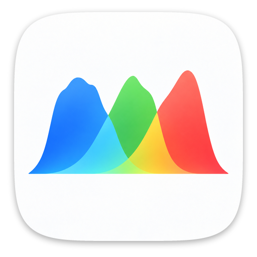
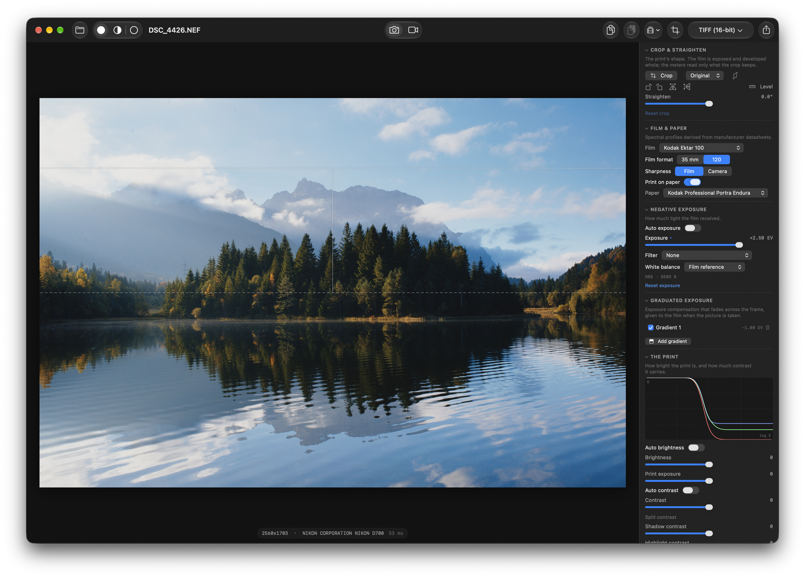
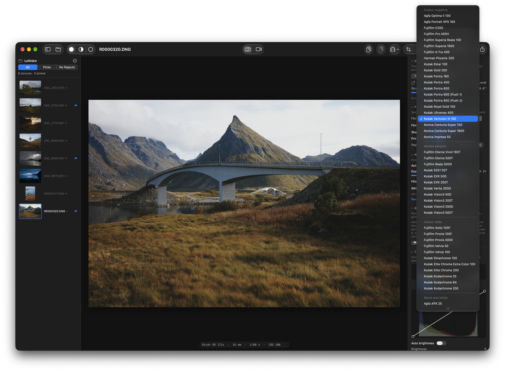

# FLX Film Lab

FLX Film Lab is a Mac and Windows app for shooting digital photos as if they
were film.

**Its films are physical models, not presets.** Each of its 55 film stocks,
whether colour negative, slide, cinema, black and white or instant, is modelled
from its manufacturer's datasheet. That means the spectral sensitivity of each
layer, its characteristic curves and the dyes it forms, with the development
couplers that shape its colour. The light in your RAW file exposes that virtual
film, which is then developed and printed onto paper, viewed as a slide on a
light table, or, for a Polaroid, seen as the print it develops into.

**Around them sits a hybrid workflow, half digital camera and half darkroom.**
- **Before the negative:** exposure correction, white balance set by the film,
  auto exposure that keeps the stock's highlights, graduated filters, and
  camera filters: Wratten filters for black and white, warming and conversion
  filters for colour.
- **After it:** a print on paper, or on a motion picture film's own print film,
  with paper grades and split grade, tone and colour controls, dodge and burn,
  and a crop.
- **Beyond stills:** the same looks grade log video, and bake into LUTs for a
  Lumix camera's Real Time LUT or an iPhone camera app.



It is a native SwiftUI + Metal app. There is no Python at runtime, no LibRaw, no
bundled interpreter: it opens RAW files from any camera macOS supports through
macOS's own RAW pipeline and runs the whole film model on the GPU. On Windows
it is the same engine in C++ and Qt, with a RAW decoder of its own (*Windows*).

- **The physics** is a port of [agx-emulsion / spektrafilm][agx] — real spectral
  sensitivities, characteristic curves and dye absorption spectra read off
  manufacturer datasheets, plus DIR couplers, halation and a stochastic grain
  model. FLX Film Lab ships with 55 film stocks and 14 print stocks, among them
  eleven black-and-white films, a black-and-white paper, a black-and-white
  print film and three Polaroid instant prints. Slides are read off a virtual
  light table rather than printed, white-balanced on the film base, as a
  projector or a scanner treats clear film.
- **The controls** follow [NegPy][negpy]'s darkroom ergonomics — ISO-R grade,
  split grade, separate shadow and highlight density, independent toe and
  shoulder, regional colour timing, and masked dodge & burn where each mask
  carries its own contrast filter.

Both are GPLv3; so is this. See `NOTICE.md` for attribution and for the list of
places where this deliberately departs from either reference.



## Download

Each release comes as a disk image: open it and drag FLX Film Lab to
Applications. The app is not signed with a paid Apple developer certificate, so
macOS refuses the first launch, calling it damaged or from an unidentified
developer. Run this once in Terminal, then open it normally:

```bash
xattr -cr "/Applications/FLX Film Lab.app"
```

It needs macOS 26 or later, on a Mac with Apple Silicon. FLX Film Lab 1.1.1,
the last for macOS 14 and 15 and for Intel Macs, stays on the releases page.

For Windows, releases from 1.3.0 also carry an installer, `FLX Film Lab
<version> Setup.exe`. It installs the app for the person running it, without
administrator rights, and offers it under Open with for RAW, JPEG, TIFF and
movie files, never as their default. It is not signed either, so Windows
SmartScreen may hold it back: More info, then Run anyway. It needs 64-bit
Windows 10 or 11 (it is tested on 11) and a graphics card with Direct3D 12
or 11.

Releases also carry a V-Log LUT pack, `FLX-Film-Lab-V-Log-LUTs-<version>.zip`,
for a Lumix camera's Real Time LUT: every film stock on its usual paper, slides
on a light table and Polaroid's prints as they develop at 70 F, Tri-X pushed two
stops and through its five camera filters, and, for daylight, EXR 200T through a
Wratten 85 and an 85B on Fujifilm F-CP 3519 and Kodak 5251 through an 85 on
Kodak 5385, to load onto the camera and shoot without the app. Its read-me says
how.

## Built on spektrafilm, and what is new here

spektrafilm is the foundation. Its physical model of exposure, development,
printing and scanning, and most of its film data, are what everything here
stands on. Its author describes it as a reference implementation, the place
where the model grows, with a Python desktop GUI for exploring it. FLX Film Lab
sets out to be something else: a tool to photograph and grade with. Getting
there meant a native port of the whole model, a film library more than twice
the size, rebuilt slide films, a capture and darkroom workflow of its own, and
a video mode. That is where most of the work in this repository went.

### What it uses

- **spektrafilm's model.** This covers spectral upsampling of the scene, each
  film's spectral sensitivities and characteristic curves, development with DIR
  couplers, the dichroic colour enlarger, the print and the scan, and in-emulsion
  scatter and halation. It is ported to Metal function by function and held to
  the original: film exposure and negative density match bit for bit, the final
  colour to within 6e-4 (`tests/parity`). Its grain model, a count of the
  particles that develop in each emulsion layer, is where the app's grain starts
  (*Grain*).
- **spektrafilm's data.** 14 of the 55 film stocks are spektrafilm's: Kodak
  Portra 160, 400 and 800 (and Portra 800's two pushes), Ektar 100, Gold 200,
  Ultramax 400, the four Vision3 stocks, Verita 200D, and Fujifilm C200, Pro
  400H and X-TRA 400. They are used as they are, but for one change: Vision3
  200T and 500T are balanced for the 3200 K lamp their datasheets name, where
  spektrafilm balances them for a household bulb of about 2810 K. Only each
  layer's sensitivity level moves, and with it the enlarger filtration that
  prints them neutral, solved again in spektrafilm's own pipeline; the curves,
  dyes, couplers and grain are spektrafilm's (*White balance*, `NOTICE.md` item
  16). All eight of its print stocks are used as they are. The colour profiles
  built here take from its sister stocks what a datasheet does not give, such as
  base densities and coupler matrices; `NOTICE.md` lists it stock by stock.
- **NegPy's design.** The darkroom controls, the print meters, and the glow
  and halation effects follow NegPy; no NegPy code is used.

### What is new

- **A native app.** The model runs on the GPU. A slider move re-renders the
  2560-pixel preview in about 29 to 50 ms, and a 45-megapixel NEF renders at
  full resolution in under a second on an M4 Pro. RAW files decode through macOS
  itself, and nothing in the app needs Python.
- **Camera-side controls, before the negative.** spektrafilm's controls are
  mostly the model's own parameters: coupler and channel switches, curve gamma
  factors, spectral upsampling options. That suits a reference. FLX Film Lab puts
  a camera in front of the negative instead:
  - **Exposure** moves the scene along the film's curve with the print time held
    fixed, so over- and under-exposure look the way they do on film. spektrafilm
    re-times the enlarger by default, which hides the change.
  - **Auto exposure** places the scene within the stock's own highlight
    headroom, rather than metering the frame to mid-grey.
  - **White balance** defaults to the light the film is balanced for, D55 for
    daylight film and a 3200 K lamp for tungsten film, so daylight film under
    tungsten light goes orange and tungsten film in daylight goes blue.
  - **Graduated exposure** stacks plus-or-minus gradients and ovals on the
    negative, like grad filters on the lens.
  - **Camera filters**, measured, with their filter factors: Kodak's Wratten
    filters for black and white; for colour film Kodak's Wratten 81C, 85 and
    85B and Tiffen's 812, each applied through the film's own spectral
    sensitivities. The 85 and 85B convert daylight for tungsten film, their
    factor and print time set in daylight, the light they are made for.
- **A darkroom, after the negative.** This follows NegPy's design:
  - contrast as an ISO-R paper grade, with split grade;
  - brightness, shadows, highlights, blacks and whites on the print's lightness,
    plus toe and shoulder;
  - colour timing through the enlarger's filters, and in the shadows and
    highlights separately;
  - pre-flash;
  - dodge and burn with polygon, oval and gradient masks, each with its own
    contrast;
  - print meters that read the frame the way a printer reads a negative;
  - slides viewed on a light table and white-balanced on the film base;
  - the print cropped, turned, mirrored and levelled, with the grain drawn on
    the print as it is cut.

  spektrafilm's print side offers print exposure, the yellow and magenta
  filters, pre-flash, auto-compensation, and gamma factors that reshape the
  paper's curve, overall, per channel and per sub-layer.
- **Curves, a histogram and a loupe.**
  - Point curves on the finished print, one for all three channels and one
    for each, on its values as the file will hold them.
  - The finished print's RGB histogram, and behind the curves the histogram
    of what they are given.
  - A loupe that shows the print at 100%, its pixels the export's.
- **Undo and redo**, one step per gesture, with a history for each image.
- **44 more stocks, each from its own datasheet.**
  - 37 film stocks spektrafilm does not have: Fujifilm Astia 100F, Provia
    400X, Velvia 50, Superia 1600, Superia Reala 100, Eterna Vivid 160T,
    Eterna 500T, Reala 500D and Neopan 1600; Kodak Kodachrome 25 and 200,
    Elite Chrome Extra Color 100, Elite Chrome 200, Royal Gold 100, Vericolor
    III 160, EXR 50D, EXR 200T, 5251 50T, Tri-X 400, T-Max 100 and Double-X
    5222; Agfa Optima II 100, Portrait XPS 160 and APX 25; Ilford HP5
    Plus, Delta 100, Delta 400, FP4 Plus, Pan F Plus and Ortho Plus; Konica
    Centuria Super 100, Centuria Super 1600 and Impresa 50; HARMAN Phoenix
    200; and Polaroid's peel-apart prints, 553, Polapan Pro 100 and Polacolor
    559.
  - Tri-X pushed two stops, and Ilford Multigrade paper.
  - Five motion picture print films to print on, beside Kodak's 2383 and
    2393: Fujifilm's F-CP 3519, F-CP 3510 and Eterna-CP 3513DI, Kodak's
    5385 of 1962, and Kodak's black-and-white 2302. A motion picture film prints
    on its own print film, as a lab prints it.

  Each profile's characteristic curves and spectral sensitivities, and, where
  the sheet plots them, its dye spectra and MTF curves, are read off the sheet's
  own plots (`tools/bake`).
- **Slide films, rebuilt.** All eleven slide films come from their own sheets.
  That includes the four spektrafilm has, Provia 100F, Velvia 100, Ektachrome
  E100 and Kodachrome 64, whose profiles here replace its own.
  - **Colour:** spektrafilm sets coupler strength by eye. Here each slide's
    colour is checked against what its sheet says about it next to its sister
    stocks, and set from it where they disagreed.
  - **Sharpness:** each slide is fitted to its sheet's MTF curve. That took two
    engine changes, a share of the inhibitor that diffuses and a cap on its edge
    gain, and a grid sixteen times finer for inverting the couplers.
- **Black and white.** spektrafilm's main line is colour only; its
  black-and-white work sits on an unmerged branch. Here eleven black-and-white
  films, Tri-X's two-stop push, a silver paper and a silver print film are built
  from datasheets alone, as noted above. They run neutral through the
  three-layer engine, with grain and sharpness from Kodak's and Agfa's published
  data.
- **Instant prints.** Polaroid's peel-apart films are their own print: shown
  as they develop, on their own 4x5 frame, at the processing temperatures their
  sheets plot (*Instant prints*).
- **Grain from the datasheets.** spektrafilm gives every colour stock the same
  grain, set by eye. Here each stock has its own, from its sheet: Fujifilm's
  and Agfa's RMS granularity, Kodak's Print Grain Index, and for the Vision3
  and EXR stocks Kodak's granularity curves for each layer, whose Vision3
  shape every other colour negative follows. It is drawn per emulsion layer,
  coarsest where a negative is thin, with dye clouds and silver clumps of a
  real size on the film, so the preview shows the grain a full-size export has
  (*Grain*).
- **Video.** The Motion mode grades log footage through the same engine as
  photographs, live while it plays, and exports the graded clip. Output is
  ProRes 422 HQ or 10-bit HEVC, with audio and metadata kept, encoded so that
  QuickTime, Photos and Safari show what the preview shows.
  - It reads N-Log, V-Log, Apple Log and Apple Log 2, F-Log and F-Log2, Canon
    Log 2 and 3, S-Log3 and I-Log, and tells the format from the file or the
    camera.
  - It meters each clip for slide film, and adds bloom, glow and halation
    on the print.

  spektrafilm has no video mode.
- **LUTs of the app's own look.** spektrafilm has a capable LUT creator of its
  own, with more log inputs and LUT formats: ARRI, RED and DJI log, HDR, `.3dl`,
  Hald images and OCIO configs.
  - `flxlut` and Export LUT… bake the look exactly as it is set in the app,
    print grade, split grade and filters included, from the same engine as the
    preview.
  - They cover every format the Motion mode reads, Apple Log 2 and Canon Log 2
    among them.
  - The output is ready for a Lumix camera's Real Time LUT and for iPhone camera
    apps, and the baker is checked against the engine (`lutchecks`).
  - Each release carries a V-Log pack of every stock, for a Lumix camera
    (*Download*).
- **Checked as it goes.** Besides the parity harness, invariant checks cover
  what parity cannot see. Separate suites cover the app, the LUT baker and the
  video path (*Verification*).

## The pipeline

Scene light in, print out. Each stage names its origin in the shader source.

| Stage | What happens |
|---|---|
| RAW decode | `CIRAWFilter`, scene-referred and linear — no tone curve, no highlight boost, no gamut mapping, and none of the "shadow bias" Apple otherwise subtracts, which put the darkest light the sensor recorded below zero. No luminance noise reduction, so the film's grain is the texture; colour noise reduction and sharpening stay at Apple's defaults for the camera. White-balanced for the *film's* reference illuminant, not as-shot |
| Film exposure | RGB → XYZ (CAT16 to the stock's reference illuminant) → chromaticity → a baked 192×192 LUT that carries the whole spectral upsampling *and* the film's 81-band sensitivity projection; through a camera filter, the film's own LUT for it, its sensitivities times the filter's transmittance |
| Scatter & halation | linear irradiance propagated through the emulsion and reflected off the base — the red bloom around bright edges. Sharpness, under Film & Paper, set to Camera leaves the scatter out, and the couplers' spread with it, so a picture keeps the camera file's own detail with the film's colour, halation and grain |
| Development | characteristic curves plus DIR couplers: inhibitor released as density forms, diffused, then re-developed against the pre-coupler curves |
| The print's shape | when the print is cropped, turned or levelled, the developed negative is shaped with it, and everything after runs at the print's own size (*Crop, turn and level*) |
| Grain | each stock's own granularity, per emulsion layer, with dye clouds or silver clumps of a real size on the film (*Grain*). The film format, 120 (a 6×9 frame, 84 × 56 mm) by default or 35 mm, sets how much the frame is enlarged, so the same emulsion is finer on 120; an instant print has its own 4x5 frame. Added as texture only: every region averages to the grain-free light, so a full-size export matches the preview |
| Enlarger | 81-band integral through the negative's dyes, a tungsten-halogen source and CMY dichroic filters, onto the paper's own sensitivities |
| Dodge & burn | per-pixel print-exposure and local-grade map |
| Paper | the paper's characteristic curve, reshaped by the tone controls |
| Scan | 81-band integral under the viewing illuminant → XYZ → output RGB, with gamut compression |
| Curves | last of all, after bloom and glow: the point curves, on the print as its file encodes it, RGB first, then each channel (*Curves and the histogram*) |

The enlarger, dodge & burn, the paper and the scan are one fused Metal kernel,
which is why the tone controls are instant: a slider move re-runs only the
per-pixel print stage, not the film.

## Opening and exporting

FLX Film Lab has two modes, switched in the middle of the toolbar or with ⌘1
and ⌘2: **Stills**, for a RAW photograph, and **Motion**, for a log video clip
(*Motion mode*). Each keeps its own file open while the other is in front, and
a file opened from Finder goes to the mode that reads it. In Stills, drop a RAW
on the window, or use Open.

Export writes a 16-bit TIFF, a JPEG or a PNG with the output profile embedded,
and carries the photograph's metadata over from the source — when it was taken,
the camera, the lens, the exposure, where — for NEF, DNG and any other file
macOS can read. It adds what made the print: FLX Film Lab and its version as
the software, and the film, its camera filter and the paper in the EXIF user
comment, after any comment the camera wrote: *Film: Kodak Tri-X 400; camera
filter: Red, Wratten 25; paper: Ilford Multigrade RC Deluxe*, or for a slide
*viewed on a light table*, for a Polaroid *instant print, processed at 70 F*.
The same line is the image description, where Photos and Lightroom find a
caption, unless the camera or an editor left one.

## Opening another image

The image on screen stays, with everything you did to it, until the new one has
actually decoded — a file that will not open changes nothing, and Export waits
until loading is done so it never mixes one image's file with another's
settings.

Each image's edits are remembered for the session: going back to one restores
it exactly. An image opened for the first time keeps the *look* — film, paper,
print or transparency, the film character and the output settings — while
everything dialled for one frame starts fresh: exposure, white balance, tone,
colour, gradients, dodge-and-burn masks and the crop. So do the autos, whatever
the last image had: Auto Exposure on, Auto Brightness and Auto Contrast off. A
section's Reset puts them back the same way.

**Undo** and **Redo**, in the Edit menu or ⌘Z and ⇧⌘Z, take back the last
change and do it again. A step is one gesture: a slider from press to release,
a handle, a crop edge or a curve point dragged on the picture, a click on a
switch, a choice from a menu, a reset or a paste. A double-click that resets a
slider is one step with its two clicks, so ⌘Z puts the slider back where it
was. The Edit menu names the step it would take back: Undo Exposure, Redo Add
Mask. Each image keeps its own history for the session, and a cancelled crop
leaves none behind. A text field being typed in keeps its own typing's undo.
Motion keeps a history for each clip the same way; how its files are written is
a preference, not part of it.

**Copy Settings** and **Paste Settings**, in the toolbar or ⇧⌘C and ⇧⌘V, take
one image's settings onto another: film, paper, print or transparency, camera
filter, every slider and auto, and white balance. Masks, gradients and the crop
belong to the frame they were made for, so the image pasted onto keeps its own.

**Presets** keep settings for later sessions. Save Settings as Preset…, in the
toolbar's Presets menu next to Copy and Paste, saves what Copy Settings would
copy under a name. Choosing the preset puts it on the image on screen, as Paste
Settings does. Each preset is a small JSON file in
`~/Library/Application Support/FLX Film Lab/Presets` (Show Presets in Finder),
so it can be shared by copying the file. A file copied in appears when the app
next comes forward, and Delete Preset moves the file to the Trash.

## White balance

The decode is balanced for the illuminant the loaded **film** is balanced for —
D55 for a daylight stock, a 3200 K lamp for a tungsten one — not for the scene. D55 is
set as its chromaticity, not as "5503 K": Core Image reads a bare temperature as
a lamp of that colour, which is pinker than daylight, and every daylight frame
then decoded green-yellow. The 3200 K is set as its chromaticity too, the
Planckian 3200 K, which Core Image's own "3200 K" misses by 14 K.

The tungsten stocks are balanced for 3200 K because their datasheets are: "balanced
for exposure with tungsten illumination (3200K)", Kodak's say, and Fujifilm's
expose their curves to a "3200K tungsten light source". agx balances its Vision3
200T and 500T for a household bulb of about 2810 K instead, which left a 3200 K
lamp printing blue (b* -6 to -9); only each layer's sensitivity level differs
for it here. A 3200 K lamp now prints neutral, and household bulbs warm, as
they do on tungsten film.

That is the whole point. A daylight film shot under tungsten really does go
orange, and Vision3 500T in daylight really does go blue; that is the emulsion
reacting to light it was not designed for. Decoding "as shot" lets the camera
neutralise the illuminant before the film ever sees it, which quietly throws all
of that away and makes every stock behave as if the light were perfect. As shot,
Daylight D55 (the daylight stocks' own balance), Daylight D65, Tungsten 3200 K
(the tungsten stocks'), Tungsten 2850 K (a household bulb) and Custom are still
there when you want a neutral start.

## Exposure

Exposure moves the scene along the film's characteristic curve — the negative
receives more or less light, exactly as if you had changed the aperture.

agx's default re-times the enlarger to match (`print_exposure_compensation`),
which is the darkroom reflex: a denser negative gets a longer print time. It
also makes the control invisible, because the print comes out the same
brightness either way. Here the print time is held fixed, so exposure does both
halves of what over- or under-exposing film does — the negative sits somewhere
else on its curve *and* the picture gets lighter or darker, with highlights
rolling into the shoulder instead of clipping. (This is also what agx itself
does under `lut_mode`, so the parity references are unaffected.)

Exposure comes first and is authoritative: Auto Brightness meters the result of
whatever exposure you set and corrects what is left, rather than trying to undo
it.

**Warming and conversion filters for colour film.** Every colour film, slide,
negative or motion picture, can be shot through Kodak's Wratten 81C warming
filter or Tiffen's 812, or Kodak's Wratten 85 or 85B conversion filter, chosen
under Negative Exposure (Exposure on a slide), each read off its maker's own
transmission curves. A filter is applied as what it is: the film's own spectral
sensitivities, wavelength by wavelength, times its transmittance, so each layer
sees the scene's light through it as the film would on the camera, rather than
as a shift of white balance. Exposure opens up by the filter factor the film's
green layer measures, so the picture keeps its brightness: about half a stop
for the 81C and 812 and about one for the 85 and 85B, more than their ratings,
a third and two thirds, which are a meter's luminous readings. The 812 adds
about the 81C's red with half its yellow, and leans pink. The 85 and 85B
convert daylight for tungsten film, so their factor and the print time are set
in daylight, the light they are made for. Measured, both go further than rated,
taking daylight to about 3300 K and 2800 K rather than 3400 K and 3200 K: a
tungsten film in daylight prints a grey a little cool through the 85, the
filter Kodak names for its tungsten stocks, and a little warm through the 85B.
On a daylight film they warm strongly.

## Metering

Two meters, doing two different jobs — which is the point, because a single
brightness meter ends up normalising every scene to mid-grey and a night shot
comes out looking like noon.

**Auto exposure** decides where the scene sits on the *film's* latitude. It
places the top of the scene inside the stock's own highlight headroom, never
pushes further than the median asks for, and then goes only part of the way —
so a frame that was deliberately exposed dark stays dark.

The print meters read the frame the way a printer reads a negative: block
averages on a coarse grid, pushed through the film and the enlarger, and only
the parts of the frame that carry texture get a vote — NegPy's texture gate,
after Boyack & Juenger. Sky, a black backdrop or a flat wall would otherwise
decide the print.

**Auto contrast** fits the frame onto the paper. The textured range, darkest
tone to lightest, has to land between a black that still holds detail and a
white that is still tone. Where the negative carries more range than that, the
grade softens until it fits — that is what keeps shadows from being crushed.
Where the frame is flatter than the paper, the grade hardens only a third of
the way and never past R92, so a flat scene stays a little flat rather than
turning garish.

**Auto brightness** then pulls the textured middle tone partway toward where an
18% grey prints, by moving the same midtone curve the Brightness slider drives.
Auto Exposure has already done most of that work on the negative, so the pull is
gentle, and paper black and white stay where they are.

All three read only what the crop keeps (*Crop, turn and level*).

Each auto puts its slider where the meter reads and keeps it there as the
frame, the stock or the controls upstream of it change. Moving the slider takes
over from that position and turns the auto off; turning the auto off by hand
leaves the slider where it was. Export prints with exactly the values the
sliders show.

## Graduated exposure

Exposure compensation that fades across the frame, given to the film when the
picture is taken: the capture-side counterpart of the darkroom gradient in
Dodge & burn. A burn can only darken what the film recorded; this changes what
the film receives, so a darkened sky moves down the film's own curve, off a
slide's clear base or a negative's shoulder, and keeps the detail it would
otherwise have lost.

Add a gradient and set its Exposure, in EV like the main Exposure slider:
negative gives the covered side less light, positive more. On the image, the
full compensation is at the solid line and none past the dashed one, with the
darkroom gradient's smooth transition between: handles close together for a
hard edge, far apart for a soft one. The handle between them moves both.

Or add an oval, to give a subject more light or its surroundings less. Its
centre and the ends of its two axes are handles, as a Dodge & Burn oval's, so
it can be stretched, tilted and sheared, and the centre moves it. The
compensation is full inside the oval shrunk by its Feather, the solid line,
and fades out to the oval itself, the dashed one: Feather 0 is a hard edge, 1
a fade from the very centre. Invert puts the compensation outside the oval
instead, and the two lines swap.

Gradients and ovals stack, up to eight, and where they overlap their exposures
add: a sky held back from the top and a face lifted with an oval, say. In the
engine they scale the light in `film_expose`, after Exposure and before
halation.

Nothing else follows them. The meters read the frame as if the gradients were
not there, so neither Auto Exposure nor the print autos move when they do, and
each changes only the part of the frame it covers. They belong to the frame,
like the masks, and stay out of LUTs.

## Black and white

**Kodak Tri-X 400**, also pushed two stops, **Kodak T-Max 100**, **Ilford HP5
Plus**, **Ilford Delta 100** and **Delta 400**, **Ilford FP4 Plus**, **Ilford Pan F
Plus**, **Ilford Ortho Plus**, **Fujifilm Neopan 1600** and **Agfa APX 25** print
on **Ilford Multigrade RC Deluxe**, and **Kodak Double-X 5222**, Kodak's
motion picture negative, on its release print film, **Kodak 2302**, each built
from its maker's datasheet (`docs/profiles.md`). Picking
one moves the print onto Multigrade, or Double-X onto 2302, and picking a
colour film again moves it back; a paper chosen on purpose for the kind of film
already loaded stays.

- **The film is panchromatic, and bluer than the eye.** Each film sees the scene
  through its own measured spectral sensitivity, so an unfiltered blue sky
  prints lighter and a red darker than their luminance — what yellow and red
  filters exist to correct. Of equal-luminance patches, Tri-X prints the blue
  at L* 75 and the red at 57. HP5 Plus leans less blue. Ilford Ortho Plus is
  orthochromatic, blue and green sensitive only: it sees nothing past 565 nm,
  so reds print dark and skin darker than on a panchromatic film, and it takes
  only the filters Ilford gives it factors for, blue, green and yellow.
- **Camera filters**, under Negative Exposure: blue, green, yellow, orange and
  red — Kodak Wratten 47, 58, 8, 22 and 25, read off Kodak's own transmission
  curves. Each film has its own exposure LUT per filter, its sensitivity times
  the filter's transmittance, with the exposure opened up by the filter factor
  as a photographer would, so a grey card prints the same and only colours
  move: through red, Tri-X prints that red patch at L* 80 and the blue at 30.
  The factors come out of the model — Tri-X yellow 2.4x, red 8.2x, blue 6.2x,
  against Kodak's published 2, 8 and 6 (green 9.9 against 6). T-Max 100's own
  spectral plot gives yellow 2.5x, red 10.9x, blue 5.2x and green 8.3x, where
  Kodak's table for it says 1.5, 8, 8 and 6: the sheet's plot and table
  disagree, and the film is built from the plot.
- **Contrast is Multigrade's grade.** The paper's own curve is filter grade 1,
  ISO R110 on Ilford's table, and Contrast is relative to a paper's own curve
  with 115 as neutral, so the slider reads close to Multigrade's ISO-R grades:
  around 160 for grade 00, 90 for grade 2, 50 for grade 5.
- **Silver has no colour.** On Multigrade every layer is the same silver, so
  the picture is neutral however it is filtered, and the colour controls are
  hidden. Pre-flash still holds the highlights.
- **Grain is the datasheet's, where the sheet gives it.** Kodak gives Tri-X a
  diffuse RMS granularity of 17, T-Max 100 one of 8 and Double-X one of 14, and
  Agfa gives APX 25 one of 7, read the way the datasheets read it: net density 1.0 through a
  48 um aperture. Ilford publishes none for any of its films, so each takes
  the Kodak film of its own class: HP5 Plus Tri-X's 17; Delta 100 and Delta
  400, Ilford's tabular-grain emulsions, T-Max 100's and T-Max 400's 8 and 10;
  FP4 Plus, Pan F Plus and Ortho Plus, classical emulsions as HP5's is, its 17
  stepped to their speeds as Agfa's own classical range steps (APX 25, 100 and
  400 measure 7, 9 and 14), 11.7, 9.6 and 10.5. Neopan 1600 and the push are
  below. It is one
  silver layer, so the grain is neutral, and its clumps are smaller and
  crisper than a colour film's dye clouds (*Grain*).
- **So is the sharpness.** Kodak publishes Tri-X's modulation transfer in
  D-76: above 100% at coarse detail, 112% at 8 cycles/mm, back to 101% at 24
  and 55% at 50. The hump is development's edge effect — its by-products
  spread out of dense areas and hold development back beside them — which the
  engine runs as the one silver layer's own inhibition, through the stage that
  runs a colour film's DIR couplers. It and the scatter under it are fitted to
  Kodak's curve (`tools/bake/bw_mtf.py`), within 4% from 2.4 to 71 cycles/mm;
  Ilford's films, for which Ilford publishes none, take the same response,
  each with the edge effect its own curve's slope gives it; APX 25,
  T-Max 100 and Double-X are fitted to their makers' own curves, up to 50
  cycles/mm (T-Max 109% at 5, 114% at 20, 112% at 30; Double-X 126% at 5,
  92% at 20, 68% at 30, a broad hump and a steep fall that takes the
  scatter's tail as well as its core). A colour
  film's scatter without the couplers' sharpening had left Tri-X at 36% at 24
  cycles/mm, visibly softer than any colour stock on the same file. Edge
  effects, under Film Character, sets how strong it is.
- **Neopan 1600 is shot at its rating.** Fujifilm's D-76 time for EI 1600,
  7 1/2 minutes, gives a curve whose own ISO speed point is 721: the rating is
  a push of about a stop, with the contrast that brings (average gradient
  0.81, Fujifilm's figure, which the traced curve reproduces). Mid-grey sits
  where a meter set to EI 1600 puts it, so shadows fall onto the toe as they
  do on film shot at 1600. Fujifilm publishes no MTF and no granularity, so it
  takes Tri-X's measured sharpness, and grain of RMS 23: Tri-X's 17 scaled by
  the square root of the two films' speed points, as granularity goes for one
  emulsion technology.
- **Tri-X 400 (Push 2) is Tri-X shot at EI 1600** and given Kodak's D-76 time
  for a two-stop push, 10 3/4 minutes. Kodak plots Tri-X at 6, 8, 10 and 12
  minutes, and the curves move steadily with time (contrast index 0.58 at 8,
  0.68 at 10, 0.79 at 12), so the push curve is interpolated between the 10 and
  12 minute ones along exposure at each density. A push buys contrast, not
  shadow speed: the curve's own ISO speed point is 501. Metered at 1600,
  mid-grey sits 0.40 over fog where Tri-X at 400 has it at 0.64, two stops
  under it the film is all but clear (0.07), and from mid-grey up its slope is
  a quarter steeper (0.75 against 0.61). Printed mid-grey on mid-grey at
  Multigrade's own grade 1, as every print here starts, those empty shadows
  come out dark grey and only the highlights show the push; the hard pushed
  print is a printer's harder grade, Contrast 90 for grade 2 or 70 for grade 3
  (Auto Contrast keeps both ends' detail, so it will not do it). Grain is RMS
  19: the same grains, each developed to more silver, and granularity goes as
  the square root of the density per grain (Selwyn), so Tri-X's 17 times the
  root of the two slopes, 0.718 against 0.581. The sharpness is Tri-X's.
- **Double-X 5222 prints on 2302, and is projected.** Kodak's black-and-white
  camera negative for motion pictures, rated EI 250 in daylight and 200 under
  tungsten, prints on Kodak's black-and-white release print film, 2302, which
  is projected as 2383 is. Double-X's own contrast, 0.66, times 2302's, 2.78,
  gives the projected print about 1.8: the hard, luminous look of a
  black-and-white release print, where on Multigrade the same negative prints
  much like Tri-X. Mid-grey sits at Kodak's normal exposure for its motion
  picture films, 10/EI. 2302 is blue-sensitive: it sees nothing past 500 nm.
- **On colour paper** a silver negative prints neutral at mid-grey: agx's table
  of neutral filtration only covers its own colour pairs, so the filtration is
  solved for this case — magenta and yellow until a printed mid-grey has no
  colour. A colour negative on Multigrade prints in plain grey.
- **Impossible colours are pulled in.** Deep in a shadow, demosaicing noise can
  produce a colour no light has — a negative X, Y or Z, outside the
  chromaticity triangle. agx clamps the spectral LUT's coordinate, which lands
  such a pixel on the LUT's edge, an extreme purple-red; three colour layers
  share it out, but one silver layer sees it as several times brighter than it
  is, and the dark inside of an ear printed as a light patch on Tri-X. For
  black-and-white stocks it is pulled back towards white onto the triangle's
  edge instead. Colour stocks keep agx's clamp, which the parity references
  hold them to.

## Instant prints

**Polaroid 553**, **Polapan Pro 100** and **Polacolor 559**, Polaroid's 4x5
peel-apart films, each from Polaroid Corporation's data sheet of 1999, are a
group of their own. An instant film is its own print: the exposure develops
straight into the picture, which is seen by reflection. The app shows it as it
shows a slide, white-pointed on its base, here the print's paper white, its
D-min, with a print's black, about 1.7 to 1.9 in density; it is never printed
on paper, and the picture is laid on the 4x5 print's own image, 117.5 x 88.9
mm, whatever the film format, which the inspector does not offer for them.

**Processing** picks the temperature the print develops at, among the three
each sheet plots it at: 55, 70 and 95 F (13, 21 and 35 C), each its own curves
and nothing between. 70 F is their normal. Cold, the prints come out slower
and softer, hot faster and harder, with the colour shifts Polacolor's sheet
draws. The exposure stays where you set it, as a meter's would: the sheets
open up a third of a stop to a stop for cold processing.

Polacolor's sheet covers the Polacolor ER of T-669 pack film too. It plots no
dye spectra, so its dyes are those of the set, of agx's slides and papers, that
view its curves most neutral, Fujifilm's Crystal Archive; and as its sheet
draws its print's green 0.1 to 0.4 denser than its red and blue, its greys run
magenta with any of them, a* +6 at mid-grey and +10 in the shadows: the magenta
shadows Polacolor is known for (`docs/profiles.md`).

## How shadows and highlights are controlled

This is the part the app is really for. Every control is exactly identity at its
default, so a slider at zero is provably doing nothing.

The sliders are named the way Capture One and Lightroom name them — Brightness,
Contrast, Shadows, Highlights, Blacks, Whites, Temperature, Tint — and positive
always means brighter. Underneath, each one drives a darkroom quantity, and the
tooltip always tells you which and shows its current physical value. Output →
**Control names → Darkroom** relabels everything to the underlying controls.

| Slider | What it really is |
|---|---|
| Brightness | a midtone move on the print's lightness: mid-grey moves most, paper black and white not at all |
| Print exposure | the enlarger timer, in stops — every tone moves, rolling into toe and shoulder instead of clipping |
| Contrast | the paper's contrast grade, as an ISO range value (R115 neutral) |
| Shadow / Highlight contrast | split grade: the hard-filter and soft-filter halves of a split-grade print |
| Shadows / Highlights | lightness moves confined to the dark or light half of the print |
| Blacks / Whites | the toe and shoulder — how each end of the scale rolls off |
| Blacks / Whites range | how far each roll-off reaches into the tonal scale |
| Midtone contrast | an anchor-preserving midtone gamma |
| Temperature / Tint | the enlarger's yellow and magenta dichroic filters |
| Highlight protection | paper pre-flash |

**Reset exposure**, **Reset tone**, **Reset colour** and **Reset film character**
each put their own section back to its defaults.

Brightness, Shadows and Highlights are defined on the print's *lightness* —
paper black to paper white, linear in L*, computed from the paper's own dyes —
rather than on density. Density is logarithmic: on an RA-4 paper the shadows
take up three quarters of it, so weights placed in density reached deep into
the midtones from one side and barely cleared paper white on the other, and at
full travel Highlights folded the curve back on itself. On lightness each
control keeps to its band: Brightness peaks at the paper's own mid-grey and
fades to nothing at either end; Shadows acts hardest in the deep shadows just
above black (around L* 15) and is gone just short of mid-grey; Highlights
mirrors it just below white. None of the three moves paper black or paper
white — Blacks and Whites do that — so a deep shadow can be lifted much further
than it can be darkened before it runs into black, and the same for highlights
the other way: ±100 means the most each direction can do smoothly.

The three are applied as one density change to all three dye layers at once,
looked up by their mean, rather than to each layer separately. The same curve
per layer lifts a skin tone's yellow and magenta (near mid-grey) far more than
its cyan (near white), which turned a face 15° toward yellow; moved together,
a tone gets lighter without changing hue, which is also what a print-exposure
change does. No setting, alone or combined, can reverse a tone: each band stops
short of where it could, and the curve's slope is floored for extreme
combinations.

The split-contrast and regional-colour zones use the same lightness scale, set
around where the paper prints an 18% grey.

**Colour crossover** exists because a dichroic filter can only shift a whole dye
layer in parallel — it cannot fix crossover, where shadows cast one colour and
highlights the complement. The per-layer trims can.

The Print's histogram is counted from the print on screen, in the values the
file will hold, so it cannot drift out of step with the image.

## Curves and the histogram

The Print opens with the finished print's histogram and, under it, point
curves on the print: **RGB** for all three channels together, and **Red**,
**Green** and **Blue** for each, which act after RGB.

- **The histogram** counts the print's pixels at each of the 256 values an
  8-bit file would hold, per channel, as the print is finished: curves and
  bloom and glow included. Red, green and blue are laid over one another and
  added, so they show white where they agree. A mark at either end shows a
  channel piled up at black or at white, in that channel's colour, once more
  than 0.05% of the print is there.
- **The curves** act on the print as its file encodes it, with the output
  space's own transfer curve: the values the histogram shows. Click to add a
  point (on the curve, if the click is close to it), drag it, and drag it off
  the graph to take it away. The end points set where black and white fall.
  The curve through the points is a monotone cubic, Fritsch and Butland's
  (SciPy's PCHIP), so it never overshoots them: a curve pulled up stays below
  white between its points, and a rising one never turns back on itself.
  Behind the curve is the histogram of what it is given, so the points can be
  put where the print's tones are.

The curves come after the film, the paper and the scan, so they change
nothing the film or the paper does, and the print meters read the print
before them: an auto never chases a curve. They run on the GPU, last, on the
linear print the export writes, so the screen and the file carry them alike.
Straight, they are skipped, and the print is bit for bit what it was without
them. They travel with Copy and Paste Settings and with presets, Reset tone
straightens them, and a newly opened image starts without them, as it does
with the tone sliders.

## Dodge & burn

Masks change print exposure, so a burn rides the full characteristic curve the
way a real one does. Three shapes: **polygon** (Catmull-Rom smoothed — a cut
card has no sharp corners either), **oval** (three control points defining an
affine frame, so tilt and shear are free), and **gradient** (the graduated card
edge, where handle spacing *is* the softness). Any mask can be inverted.

Each mask carries stops, feather, and a **local grade** in ISO-R points —
burning through a different filter, which on variable-contrast paper is what a
hard-filter burn actually is.

## Mask lines

**Hide Mask Lines** (⇧⌘H, in the toolbar) takes the lines of the Dodge & Burn
masks and the gradients off the print, to judge it without them: they go on
acting, and only their lines go. Choosing a mask or gradient to edit, or adding
one, shows them again.

## Crop, turn and level

The print's shape, in Stills. **Crop** (⌘R, in the toolbar or Crop & Straighten
in the inspector) shows the whole frame, turned and levelled, with the crop on
it. Drag a corner or an edge to size the crop, or inside it to move it, then
Done (Return) keeps it and Cancel (Escape) goes back.

- **Proportions:** Original, 3:2, 4:3, 5:4, 65:24, Custom (any width to height)
  or Free. The button beside them stands the crop up or lays it down. A fixed
  proportion holds to the pixel at any size: drawn on the preview, a 4:5 crop
  exports at 4:5.
- **Turns and mirrors:** a quarter turn either way (⌘[ and ⌘]), and mirrors left
  to right and top to bottom. They move pixels without changing them.
- **Levelling:** Straighten turns the picture up to 45° either way. With Level
  on, a line drawn along a horizon or an upright levels the picture to it. The
  crop shrinks as far as it must to stay inside the picture, and grows back
  when the picture is levelled back.

It is the print that is shaped, as an enlarger's easel and a trimmer would
shape it. The film is exposed, given its halation and developed whole, so a
light just outside the crop still haloes into it. The developed negative is
then turned, levelled and cropped with the print, and the grain, the print and
bloom and glow are made at the print's own size. A crop keeps the frame's
pixels at their size, so it enlarges the grain as cropping a print does.

The grain is drawn after the levelling, on the print's own pixels, so it is as
crisp between the frame's pixels as on them. Levelling is bicubic, and goes no
further than the four nearest pixels, so edges do not ring. The preview of a tight crop is the
preview's own pixels enlarged; Preview size, under Output, goes to 4096.

The meters read only what the crop keeps, turned back upright, so turning or
mirroring a print never changes how it is printed. While a crop is being drawn
they hold the reading they had, and read the new crop when it is done. Masks
and gradients stay where they were drawn on the frame, and a new one starts in
the middle of the print as it stands.

The crop belongs to its frame. It stays out of Copy and Paste Settings, out of
a newly opened image, and out of LUTs. The Motion mode has none.

## Grain

Each stock's grain is its datasheet's. The sheets give a diffuse RMS
granularity — the density fluctuation through a 48 um aperture, times 1000:

| Read at | Stocks |
|---|---|
| visual density 1.0 over the minimum | Fujifilm's, Agfa's and Konica's colour negatives and Fujifilm's slides, from their sheets |
| gross visual density 1.0 | Kodak's slides |
| net silver density 1.0 | Tri-X, T-Max 100, Double-X, APX 25 |
| Print Grain Index | Kodak's colour negatives for stills: four units are a just-noticeable step, and doubling the enlargement adds 22, so a difference of d is a factor of 2 to the power d/22. The scale is set at Portra 400 = 4, where Kodak's own curves put Vision3 250D and 500T and Fujifilm puts Pro 400H |
| per layer, against density | Kodak Vision3 50D, 250D and 500T, and EXR 50D and 200T. Vision3 200T's sheet repeats 500T's plot, so 200T sits between 50D and 250D at the 100-speed grain Kodak claims for it, and Verita 200D between them at its own speed |

A few publish nothing: Ilford's films and Neopan 1600 are derived as noted above,
Reala 500D takes Eterna 500's figure, Ultramax 400 takes Gold 200's, Phoenix
200 takes Superia 1600's, and 5251 EXR 200T's curves. Konica's Impresa 50
takes Konica's own step from Centuria Super 100 to 1600 (4 to 6 over four
stops), carried down one stop to its ISO 50: 3.6. Polaroid's sheets give none:
Polapan Pro 100 and Polacolor 559 take an estimate of 4, and 553, rated ISO
800, Polapan's 4 stepped to its speed as Agfa's range steps, 6.2. Pushed stocks
take their
normal figure times the root of the slope ratio at mid-grey (Selwyn: the same
grains, each developed to more density).

The grain follows the density the way the film's does. Kodak's Vision3 curves
show every layer coarsest just above the fog, where only the fast emulsion has
developed, then levelling off as the slower ones fill in, and blue — the
yellow-dye layer — about twice as grainy as red and green. Every colour
negative without curves of its own follows that measured shape at its own
sheet's level; the EXR stocks have theirs, and 5251 takes EXR 200T's. Slides
and black-and-white films publish no curve, so theirs comes from spektrafilm's
counting model on each stock's own emulsion layers.

It is drawn per emulsion layer, fast, medium and slow. Each layer's grain
follows Selwyn's law — the fluctuation over an area A has a variance that goes
as 1/A — so a pixel draws noise of the variance its area on the film calls for,
and the noise is spread over the layer's dye clouds or silver clumps. Their size
is micrometres on the film, larger for a grainier stock and for its fast
layer, and the same whatever the pixel pitch. So the preview and a full-size
export carry the same grain at the same viewing size, and cropping enlarges it.
Grain size scales the clouds, and the grain's coarseness with them.

Printing is not linear, so grain shifts a region's average colour, by more
where pixels are smaller. The grain's mirror image is printed as well, and the
mean of the two prints holds that shift and none of the texture; each region is
scaled back to the grain-free light by it, which keeps the grain's coarse
structure as well as its fine one.

## Bloom and glow

Two optional effects work on the finished print's highlights, before it is
encoded for the screen or a file. Both blur the frame's brightest areas; they
differ in what they do with them. Bloom spreads the highlights into their
surroundings without making anything brighter. Glow adds their light on top.

- **Bloom** is diffusion, like a mist filter on the lens: bright areas bleed
  softly into the darker ones round them, edges near lights and bright skies
  soften, and contrast falls around the highlights. It is the Photoshop
  "Pro Mist" recipe, on display values as in Photoshop: the highlights above
  Threshold are selected, blurred and laid back with Lighten. Lighten raises
  a darker pixel towards the colour of the highlight spreading over it, never
  past it, so nothing comes out brighter than the highlight it came from and
  nothing burns out. Screen and Add, under More, brighten as well. Haze adds
  the veil such a filter lays over the whole frame: a share of all the light,
  spread wide, which lifts the shadows by what it takes from the highlights.
- **Glow** adds light, like the halo round a street lamp on a damp night. The
  blurred highlights are added to the picture in linear light, the way stray
  light adds up, so a light source and what is near it get brighter, and the
  halo takes the light's colour. A soft shoulder rolls the sum off towards
  white instead of clipping it. It follows NegPy's glow.

Bloom suits a soft, low-contrast look, such as a backlit portrait; glow makes
lamps, windows and reflections shine. Used together, the bloom goes on first.

Sizes are fractions of the frame's long edge, so the preview blooms exactly as
the full-size export does, and a crop enlarges them as it enlarges the grain.
They run in Core Image on the renderer's own texture and command buffer, in
float throughout, so a 16-bit TIFF keeps its precision. Both are off by default
and travel with the look to the next image. The Motion mode adds a halation
effect; Stills leaves it out, since the film model's own halation, the physical
one, does that job here.

## The loupe

**Loupe** (⌘L, in the toolbar) lays a square over the print that shows it at
100%: one pixel of the full-size export to one pixel of the screen. Drag it
over the print. It shows what the export will: the grain, the halation, the
couplers' edges and the sharpness at the size they come out at, which a
fitted preview cannot.

While the loupe is open the picture is held at full size on the GPU, decoded
as the export decodes it: 0.44 s for a 45 MP Nikon Z 7 frame, which then
holds 720 MB until the loupe is put away. Only the part under the loupe is
printed, with the values the preview resolved, from a box of the frame wide
enough for every blur and the grain's filters to reach into it, so it draws the
same grains and the same dodges and burns as the whole print. Bloom and glow
reach further than a part can hold, up to 8% of the frame's long edge, and
take the light from beyond it from the preview's print. The loupe's pixels are
the exported file's to 1 of 255. A move takes about 7 ms on a 45 MP frame,
16 ms with bloom and glow on a levelled print.

## Surround

Three canvas backgrounds — dark, middle grey (L* 50) and white — on a segmented
control in the toolbar, or ⌘B to cycle.

Brightness and colour are judged against their surround, not in isolation: the
same print reads heavy against white and washed against black, which is exactly
why a darkroom uses a neutral wall and why every printing standard specifies
one. Flipping between the three is how you tell a genuinely dark print from one
that only looks dark.

It changes nothing about the render — it is a viewing preference, kept out of
`Recipe` so it never lands in a sidecar.

## Motion mode: log video

FLX Film Lab's Motion mode (the video camera in the toolbar, or ⌘2) grades log
clips — Nikon N-Log, Panasonic V-Log, Apple Log and Apple Log 2, Fujifilm
F-Log and F-Log2, Canon Log 2 and 3, Sony S-Log3, Insta360 I-Log — with the
same engine, Portra 800 printed on Portra Endura by default, and writes the
graded clip.

Every stage of the engine that works pixel by pixel — film exposure,
development, the couplers' colour, the enlarger, the paper and its tone
controls, the scan — is a fixed function of the pixel's own colour, so it is
sampled once on a 65³ lattice and interpolated. A bake is one render of the
lattice, about 10 ms, so every slider move re-bakes and the frame on screen
redraws at once, playing or paused. Each frame is read straight off its
decoded Y′CbCr planes — no colour management, no conversion — into the log
format's own values, looked up, and then given bloom, glow and halation in
Core Image. Preview and export run the same code; the effects' sizes follow
the frame, so the smaller preview blooms the way the full-size export does.

**N-Log in.** The curve is Nikon's (N-Log Specification 1.0.0), defined on
10-bit code values: an 18% grey records at code 372, scene black at 127. A Zf
(firmware 2.00) writes those code values as they are into full-range 10-bit
HEVC tagged BT.709, so they read straight off the file. Nikon gives N-Log's
primaries as BT.2020, which is already the engine's working space. Levels and
the Y′CbCr matrix follow the file's own tags and can be overridden under Log
Input. Hovering over the picture shows the code values under the pointer, and
the stops from grey — a grey card exposed the way Nikon recommends reads 372,
and prints as mid-grey at Exposure 0.

**Other log formats.** V-Log (Lumix) is defined on code values like N-Log —
grey at 433, black at 128 — but in V-Gamut, wider than BT.2020, so its decode
adds a matrix; Apple Log (iPhone 15 Pro and later) is BT.2020 but defined on
the 0–1 signal once the file's levels are out, not on code values, so a
video-range file reads differently; Apple Log 2 (iPhone 17 Pro and later) is
Apple Log's curve in Apple Wide Gamut. The grade kernel hands the baked look
whichever value the format is defined on, and the look is baked for that
format, so each one prints the light it recorded: an 18% grey prints the same
from all of them.

Fujifilm's F-Log and F-Log2 (Fujifilm's data sheets), Canon Log 2 and 3
(Canon's input transform, v1.2) and Sony's S-Log3 (Sony's technical summary),
with their constants as colour-science gives them, are all defined on code
values, like N-Log: an 18% grey records at code 470, 400, 407, 351 and 420,
scene black at 95 (128 for Canon Log 3). F-Log and F-Log2 record in F-Gamut,
which is BT.2020; Canon's in Cinema Gamut and Sony's in S-Gamut3.Cine or
S-Gamut3, which all reach outside BT.2020, so their decode adds a matrix
derived from the primaries each maker publishes. `lutchecks` holds every
curve to colour-science's value for an 18% grey and every matrix to
colour-science's, and the same scene prints the same through each as through
N-Log.

Insta360's I-Log (Insta360's 10-bit I-Log white paper, June 2026) is defined
on code values too: an 18% grey records at code 432 and scene black at 93,
and code 1023 is 6.9 stops over grey. It records in BT.2020, so its decode is
the curve alone. colour-science does not have it, so `lutchecks` holds it to
the white paper's own table.

Apple tags its log footage (Core Video's log transfer function), so an iPhone
clip is recognised; a Sony camera names its curve and gamut in the
NonRealTimeMeta XML it writes into the file. Otherwise the camera's maker
decides: a Lumix records V-Log, a Fujifilm F-Log2 where the model has it and
F-Log before, a Canon most often Canon Log 3 (Canon Log 2 has to be chosen),
a Sony with no XML S-Log3 in S-Gamut3.Cine, an Insta360 I-Log (its clips are
tagged BT.709 whatever they hold); anything else is taken for N-Log, which a
Zf writes untagged. A real Lumix S1H clip is read as V-Log this way; none of
it has been tried on a real Fujifilm, Canon, Sony or Insta360 file yet. The
format shown under Log Input says which it was, and can be overridden for
that clip: the next one is read from its own tags. Read as N-Log, an Apple Log
clip's grey card would print at L* 71 instead of 49.

**Exposure, and slides.** At Exposure 0 a clip prints the way it was
exposed. That suits a negative, which holds seven to nine stops above an 18%
grey, but a slide runs to clear film about one and a half stops above it, and
N-Log keeps six: printed as shot, a bright wall goes blank and the picture
reads flat and washed — which is why slide film is exposed for its
highlights. *Auto exposure* (on by default) does that once per clip: in each
of nine frames spread across it, the level only the brightest 2% of the picture
exceeds; the middle of those across the clip, so one shot of a window does not
darken the rest; then, with the Stills mode's half-stop margin and partial pull,
exposure is pulled down only as far as the stock needs to hold it, and never
more than two stops. It never brightens, so negatives print exactly as shot;
on a bright indoor Zf clip Ektachrome is pulled 0.4 EV and Velvia 50 0.8.
Lamps, windows and speculars burn out, as they would on the real film. Moving
the slider takes over from the meter.

**White balance** happens in the camera, before N-Log. A fixed 5500 K on the
camera is what loading daylight film was: tungsten light then goes orange, as
it would on Portra. For a tungsten stock 3200 K is the film's own light, and
daylight goes blue unless it is shot through an 85. Temperature and Tint
correct it the way a lab would, with the enlarger's filters.

**Black and white.** Tri-X, Tri-X Push 2, T-Max 100, HP5 Plus, Ilford's
Delta 100 and 400, FP4 Plus, Pan F Plus and Ortho Plus, Neopan 1600 and APX 25
print on Multigrade, as in Stills: picking one moves the print onto
silver paper, which has no colour to balance, and the same camera filters
(Wratten 47, 58, 8, 22 and 25) sit under Film & Paper. Double-X 5222, Kodak's
black-and-white motion picture negative, prints on its release print film,
2302, as a cinema would show it. The halation effect, red on colour film,
glows grey in a black-and-white picture.

**Motion picture film, filters and instant prints, as in Stills.** A motion
picture film prints on its own print film, colour films take the 81C, 812, 85
and 85B under Film & Paper, and Polaroid's instant prints are seen as the
prints they are, processed at 70 F.

**What a frame cannot carry.** Grain, the film's own halation, coupler
diffusion, dodge and burn and the meters depend on neighbouring pixels or on
the whole frame, so they are not in the look. Grain is left out for now; the
halation effect stands in for the film's own.

**Out.** ProRes 422 HQ or 10-bit HEVC, chosen beside Export in the toolbar as
a still's format is, the audio copied as it is, rotation and metadata kept,
with FLX Film Lab, the film and the paper as its software and description,
tagged Rec.709. macOS and iOS decode Rec.709 video with a 1.961
power (measured with VideoToolbox, not assumed), so *Apple displays* writes the
values with its inverse and QuickTime, Photos and Safari show exactly what the
preview shows; *Rec.709 broadcast* writes for a BT.1886 (2.4) reference
display, which a Mac then shows lighter and flatter.

**A LUT for other software.** Export LUT…, or headless:

```bash
./build.sh lut
./build/flxlut "Portra 800 on Endura.cube" --exposure 0.3 --grade 105
```

A 65-point .cube, N-Log code values / 1023 in — how DaVinci Resolve hands a
full-range Zf clip to a LUT — and Rec.709 BT.1886 out (the app's Export LUT…
writes the open clip's own format: V-Log, F-Log, Canon Log, S-Log3 and I-Log
the same way, Apple Log on its signal); `--input video-levels` is for video-range
files and `--output apple` writes for Apple displays;
`--film kodak_tri_x_400 --filter red` bakes Tri-X shot through a red filter,
`--film kodak_exr_200t --filter 85b` EXR 200T through an 85B.
Per-pixel only, like the app's look. The app's Export LUT… follows the open
clip's own range.

`--input applelog` takes Apple Log from an iPhone 15 Pro or later instead
(Apple Log Profile White Paper, 2023: BT.2020 primaries, the curve defined on
the 0–1 signal). For the phone itself:

```bash
./build/flxlut "Portra 800 on Portra Endura - Apple Log 33.cube" --input applelog --output apple --size 33
./build/flxlut "Fuji C200 on Crystal Archive II - Apple Log 33.cube" --film fujifilm_c200 --input applelog --output apple --size 33
```

33 points is the size camera and editing apps on a phone accept most widely;
from Apple Log a 33-point table stays within dE2000 0.6–0.9 (p99) of the
engine, a 65-point one within 0.2–0.3.

`--input applelog2` takes Apple Log 2, which iPhone 17 Pro and later record
when Settings > Camera > Formats > ProRes Log Video Encoding is set to Log 2
(Log is still offered). It keeps Apple Log's curve but records in Apple Wide
Gamut, wider than BT.2020 (its blue primary lies outside the spectral locus,
like V-Gamut's). Apple publishes only the primaries, so the decode's matrix is
derived from them, the way OpenColorIO's built-in transform does, and
`lutchecks` holds it to OpenColorIO's own test value. The two are not
interchangeable: Log 2 footage through an Apple Log table is off by dE2000 1.5
on average and 8 at p99, most of it in saturated colours.

`--input vlog` takes Panasonic V-Log (V-Log/V-Gamut Reference Manual), for a
Lumix camera's Real Time LUT, which applies one table to both photos and
movies. V-Log is defined on code values like N-Log — grey at 433, black at
128 — but its primaries are V-Gamut, wider than BT.2020, so the decode adds a
matrix into the engine's working space. For the camera the table wants 33
points (the most it reads), full-range data and the sRGB curve (exact for a
JPEG or HEIF, between the two video curves for a movie); `flxlut` writes the
camera's base Photo Style under the title (`#LUMIXPHOTOSTYLE VLOG` — V-Log is
also what the camera assumes without it), leaves out the optional DOMAIN
lines and keeps every value inside 0–1. File names for an SD card in FAT32
are at most eight letters and digits:

```bash
./build/flxlut PORTR800.cube --film kodak_portra_800 --input vlog --output srgb --size 33
./build/flxlut TRIXRED.cube --film kodak_tri_x_400 --filter red --input vlog --output srgb --size 33
./build/flxlut P800MXDR.cube --film kodak_portra_800 --exposure 1 --grade 134 --shadow-grade -16 \
               --input vlog --output srgb --size 33
```

The last is a "Max DR" Portra for a camera set to −1 EV: the print exposure
puts the midtones back within 2.3 L* of the normal table, and a softer print
(R134, the shadows held with a harder shadow grade) spreads the highlights from
+2 to +5 stops over 13.6 L* instead of 10.8, with channel headroom for the sun
and lamps, at a stop of shadow noise: worth it at a camera's base ISO, not at
its highest.

`python3 tools/lut/vlog_pack.py` bakes the V-Log pack that goes out with a
release: every stock this way, on its reference paper (Portra 800's pushes
aside), Tri-X through its five filters, and EXR 200T and 5251 through the
filters that convert them for daylight. Tri-X, pushed and through its filters
too, HP5 Plus and T-Max 100 print at Contrast +20 (R102), as they look flat at
R115. It writes
`build/FLX-Film-Lab-V-Log-LUTs-<version>.zip`, with a read-me for the camera,
and the release workflow attaches it to each release.

`--input flog`, `flog2`, `clog2`, `clog3`, `slog3` (S-Gamut3.Cine) and
`slog3-sgamut3` take the other cameras' log, on code values / 1023; each has
a `-video-levels` twin for a video-range file as Resolve hands it. A 65-point
table stays within dE2000 0.2–0.9 (p99) of the engine for all of them, a
33-point one within 0.5–1.0, except Canon Log 3 at 2.6: its errors gather
three to five stops under grey, where its straight shadow segment meets the
log.

```bash
./build.sh lutchecks
./build.sh motiontest
./build.sh motionapptest
```

The first checks the N-Log curve against Nikon's published values, every
other format's curve and matrix as above, the lattice order, and
interpolation: a 65-point LUT stays within dE2000 0.31
(p99, worst 0.78) of rendering each pixel through the engine on scene colours.
The second writes synthetic N-Log with exact 10-bit code values (HEVC Main10,
BT.2020 tags, a tone on the audio) and checks the decode reads the codes back,
a graded frame is the engine's print of them (worst dE 0.37), the exports
decode — the way QuickTime decodes them — to what the preview shows (worst
dE 0.24), and audio, frame order, timing, partial ranges, cancelling and
rotation survive; the same chart written in each of the other formats grades
to the engine's print of its light (worst dE 0.65), with the grey card
printing within 0.1 L* of N-Log's, and each is read for what it is from its
tags or its camera's metadata. The third opens, grades, switches and
exports clips through the app's model, including an Apple Log clip known by
its tag and a format chosen by hand. A 3840×2160 frame grades in 2.3 ms, 15 ms with all three
effects on; the preview draws it in 6 ms.

Checked on a real Zf clip as well as synthetic N-Log: full range, values out
to 1023, the darkest pixels just above black at 127. The one thing a file
cannot say is whether the BT.709 matrix tag is the matrix the camera used;
on that clip reading it as BT.2020 instead moves the graded picture by dE2000
0.4 on average, 1.2 at p99 — a frame of a colour chart would settle it.

## Windows

`windows/` is FLX Film Lab for Windows: both modes, Stills and Motion, on the
same engine and the same film data, ported to C++20 and GLSL compute on Qt
6.12, and checked against the Mac app's engine stage by stage: its prints are
within ΔE2000 0.09 of the Mac's, on Direct3D 12 and 11 as on Metal. It decodes
RAW files itself, with RawSpeed and, for what RawSpeed lacks, LibRaw, and
gives each camera Apple's colour, measured from macOS's own decoding, so a
picture's colour is the Mac app's; lens correction comes from the camera's
own file, or from Lensfun's database. `windows/README.md` says how it is built
and checked. The Mac remains the main development platform: the Windows app
receives limited testing, on a single configuration, Windows 11 with an
NVIDIA RTX graphics card.

It asks Windows how much of the graphics card's memory it may use, and fits
in it: a 45 MP picture decodes on the GPU in about 7 GB, so where the card has
less free, the CPU decodes it, by the same arithmetic, in a few seconds. An
export whose whole print would not fit is printed in tiles, each as part of
the whole print, with margins for every blur that reaches into it, so the
tiles come out as the whole print's pixels; the loupe prints its part the same
way, with only that part on the card. On a card with 8 GB a 45 MP export
peaks near 6 GB. Bloom and glow at their widest reach thousands of pixels; on
a small card a tile or the loupe holds less, and their farthest light is
missing there. The preview's own share is its size's, about 1.6 GB at
2560 px with a crop and the effects.

## Build and run

Needs macOS 26+ on Apple Silicon, and the Command Line Tools. **Xcode is not
required** — there is no `.xcodeproj`, and Metal shaders are compiled at runtime
from `FLXFilmLab/Resources/Shaders/flx.metal`.

```bash
./build.sh run
```

That produces **`FLX Film Lab.app` in this folder** and launches it — double-click
it there, or drag it to /Applications. `./build.sh install` copies it there for
you.

Other targets:

```bash
./build.sh parity
./build.sh checks
./build.sh apptest
```

The first runs the numeric parity harness against reference renders from the
real Python pipeline; the second checks the app's own defaults, which parity
cannot reach (see Verification below); the third drives the document model
through opening, editing and switching images, on generated test files.

The tools and the test suites build against one module of the shared code,
compiled once into `build/core` and again only when one of its sources
changes, so after the first each builds in seconds.

`./build.sh strict` typechecks every source as the older Swift on GitHub's
macOS runners does. A newer Swift accepts some long expressions that one gives
up on; with its newer constraint-solver shortcuts turned off, it gives up on
the same ones. It needs Swift 6.4 or newer.

With only the Command Line Tools installed, `build.sh` compiles against the
newest SDK whose SwiftUI does not need Xcode's macro plugin (the macOS 27 SDK
does), and says so when it falls back. It also names that SDK to the linker,
which otherwise recorded the toolchain's default in the binary. macOS runs an
app as the SDK it records behaves, so a build here now behaves as the release,
built on GitHub with Xcode 26, does.

## Command line

The same engine, headless:

```bash
./build.sh render
./build/flxrender in.NEF out.tif --film kodak_ektar_100 --grade 95 --shadows 0.3
```

`--list` prints the available stocks; `--dump-recipe` prints a recipe JSON you
can edit and pass back with `--recipe`. `--wb` takes a white balance by its
stored name (`"Daylight D55"`, `"Tungsten 3200 K"`, ...), `--filter` a
camera filter (`red`, `85b`, ...), and `--processing` an instant print's
processing temperature (55, 70 or 95, in F).

## Verification

`tests/parity` is the check that this is a faithful port rather than a plausible
imitation. `tools/bake/bake_reference.py` renders fixed inputs — a grey wedge, a
ColorChecker under D55, saturated primaries at eight exposures, and 4096 random
samples — through the *real* Python pipeline in `lut_mode` (its deterministic
per-pixel regime), capturing every intermediate tap. The Swift harness runs the
same inputs through Metal and compares.

Current state, across six combinations — four through the full print chain
(including a positive slide film and a cine print film) and two through the
direct transparency path:

```
log_e_film   max |Δ| = 0.00000      (bit-exact)
cmy_film     max |Δ| = 0.00000      (bit-exact)
rgb_out      max |Δ| = 0.00060      (float32 rounding through the 81-band integral)
             max |Δ| = 0.00000      on the transparency path (bit-exact)
72/72 tap comparisons within tolerance
```

It is worth running when anything changes: it has already caught a positive-film
interpolation-axis bug, a wrong D-max in the coupler pass, and a tone-LUT axis
that let a clamped region bleed into a slide's highlights. The references carry
the app's own departures from agx (`stock_overrides.py`, and the couplers
inverted on the engine's finer grid), so what it checks is the port.

Parity can only check agx's own configuration — no metered exposure, no
light-table white balance, no gamut compression, sRGB out — so the app's
defaults need checks of their own:

```bash
./build.sh checks
```

These assert properties rather than reference values. Each of them failed
before the fix it guards.
- **Exposure and white balance:** the metered exposure reaches the film stage;
  the decode keeps the darkest light the sensor recorded; the daylight white
  balances decode at the CIE daylights, and Tungsten 3200 K at the Planckian
  3200 K; graduated exposure, linear or oval and inside or out, changes what the
  film receives, and only where it covers.
- **Filters:** every colour film takes the 81C, 812, 85 and 85B; on a slide a
  grey card keeps its lightness as they warm it; the tungsten films, balanced
  for a 3200 K lamp, print daylight blue, through the 85 a little cool and
  through the 85B a little warm and as light as in their own light;
  black-and-white films print a grey card the same through every filter.
- **Tone:** Brightness, Shadows and Highlights stay in their own bands; Auto
  Contrast fits the frame instead of crushing it; Temperature and Tint move
  prints and slides the same way; gamut compression leaves in-gamut colour
  alone and holds hue for the rest.
- **Films and papers:** every slide renders a grey wedge neutral, or as its
  sheet draws it (Kodak's Elite Chromes blue, Polacolor magenta), and its clear
  base white, and is as sharp as its datasheet's MTF one stop under mid-grey,
  keeping that edge effect deeper down; every colour negative built from a
  datasheet prints a full tonal range with a neutral mid-grey; the motion
  picture print films built here print any negative's greys, Fujifilm's with
  less chroma than 2383; black-and-white stocks print every pixel neutral,
  grain included, on silver paper and print film and a neutral mid-grey on
  colour paper, render a blue lighter than a red of the same luminance, and
  never print an impossible colour lighter than its luminance.
- **Instant prints:** each is its sheet's print at 55, 70 and 95 F and nothing
  between, is never printed on paper, lies on its own 4x5 frame, and is as
  sharp as its sheet's MTF on the print.
- **Grain:** every stock gives its datasheet's RMS granularity, in a pattern of
  its own; grain is the film's size whatever the pixels', so an export seen at
  the preview's size has the preview's grain and the print keeps the
  negative's coarse grain; it averages to the grain-free colour region by
  region without pushing a pixel below zero.
- **Effects and output:** Camera sharpness keeps the file's detail and the
  film's colour; bloom and glow land on their highlight and scale with the
  frame; every output space survives a 16-bit TIFF round trip through
  ColorSync.

For the crop they check the following:
- a turned, mirrored or cropped print is the frame's pixels moved, masks and
  all;
- a levelled print is printed from the levelled negative, with its grain as
  strong between the frame's pixels as on them;
- crops keep their proportions, inside the picture;
- the meters read only the crop.

## Performance

On an M4 Pro, a 45 MP Nikon NEF:

| | |
|---|---|
| Full-resolution render | 0.36 s |
| Full pipeline incl. decode and JPEG write | 1.9 s |
| Preview frame, print or tone slider (2560 px) | ~29 ms |
| Preview frame, exposure or film-character slider | ~50 ms |
| Loupe, reading the picture at full size (once) | 0.44 s |
| Loupe, each move or slider tick (600 × 600 px) | ~7 ms |

The preview is 2560 pixels on its long side. Preview size, under Output, also
offers 1024, 2048, 3072 and 4096, and the choice is kept between launches. At
2048 the two sliders take about 19 and 33 ms, at 3072 about 42 and 71, and at
4096 about 73 and 122, for a Mac with the GPU for it. A file smaller than the
preview size is shown at its own size; the preview never enlarges it. Of
those times grain takes about 6 and 10 ms at 2560, and 0.08 s of the
full-resolution render: its three emulsion layers, and printing its mirror
image, which keeps the colour without taking the grain's coarse structure away
(*Grain*).

The preview renders on its own actor (`App/RenderEngine.swift`), never on the
main thread, so the controls stay responsive whatever a frame costs; while one
frame renders, further slider ticks collapse into one follow-up with the latest
values. The window redraws only what a change touches. A finished frame
redraws the print, the status line and the histogram; the inspector waits
for its own values (`PrintPreview`). A slider tick remakes only the
inspector's section it is in (`Redrawn`). Dragging a slider on a 24 MP frame,
the main thread spends about 8 ms a tick. Each stage is skipped when nothing it
depends on changed: the developed
negative is reused while only print controls move, the meters keep their
reading of the frame, and dodge-and-burn masks are redrawn only when their
shape changes.

Past 12 MP the intermediates drop to half precision, because ten image-sized
float32 buffers would be 7 GB at full resolution. The parity harness and the
preview stay in float32, up to a 4096-pixel preview of a 3:2 frame (11.2 MP);
one of a 4:3 frame (12.6 MP) works in half precision, as its export does.

## Building profiles from datasheets

Every profile built here is read off its manufacturer's datasheet by the
scripts in `tools/bake`: vector plots straight from the PDF's drawing commands,
calibrated on each plot's own ticks and labels, and bitmaps traced on their own
grids. A profile takes from its sheet everything the sheet gives: the
characteristic curves, the spectral sensitivities, the dye spectra or the
spectral density of a neutral and of D-min, the MTF, the granularity, the speed
and what the sheet says of its colour. A donor, one of spektrafilm's measured
profiles, supplies only what no sheet of the film or its sister stocks has, and
each profile records that split in its `datasource` field.

- `docs/profiles.md` says how each stock was built, and where a sheet disagrees
  with itself;
- `docs/building-profiles.md` holds the rules every new one is held to;
- `docs/datasheets.md` lists the sheets, by title and number, and the file name
  each is expected under in `film spec sheets/`.

The datasheets themselves are not part of this source: they are the
manufacturers' documents. The app and its tests do not need them.

Note that a film's ISO rating does not change the render. agx normalises every
stock so mid-grey lands at the same place, because the ISO is what you dial into
the meter — switching stocks should change the character of the curve, not the
exposure.

## Rebuilding the data packs

Only needed if you change what gets baked, or want to pick up new upstream
profiles.

```bash
conda create -n flx-bake python=3.13
conda activate flx-bake
pip install "numpy~=2.4" "scipy~=1.17" "colour-science~=0.4.6" "scikit-image~=0.26" \
            "matplotlib~=3.10" "opt-einsum~=3.4.0" "numba~=0.64" "pyfftw~=0.15.0" \
            "OpenImageIO~=3.1.11" "exiv2~=0.18.1" lensfunpy rawpy
pip install --no-deps -e /path/to/spektrafilm

python tools/bake/build_profiles.py   # -> profiles/  (datasheet-derived stocks)
python tools/bake/build_bw_profiles.py  # -> profiles/  (black-and-white stocks)
python tools/bake/build_print_profiles.py  # -> profiles/  (the motion picture print films)
python tools/bake/build_instant_profiles.py  # -> profiles/  (the Polaroid instant prints)
python tools/bake/bake_packs.py       # -> FLXFilmLab/Resources/packs
python tools/bake/bake_reference.py   # -> tests/parity
python tools/icon/make_icon.py        # -> FLXFilmLab/Resources/AppIcon.icns, and the icon's two pictures
```

## Layout

```
FLXFilmLab/
  App/         SwiftUI entry point and mode switch, the document model, and the off-main render engine
  Engine/      Metal renderer, CPU-side model evaluation, RAW decode, export
  Effects/     bloom, glow and halation, used by both modes
  Model/       data-pack decoding, the recipe, shared constants
  UI/          canvas, inspector and its controls, curves, crop, mask and loupe overlays
  Resources/   baked packs + flx.metal (compiled at runtime)
  Motion/      the Motion mode
    App/       the clip model
    Video/     frame pipeline, playback, preview, export, look baking
    UI/        preview canvas, transport, inspector
    Resources/ motion.metal (compiled at runtime)
profiles/      film profiles this repo builds from datasheets
tools/bake/    Python: datasheet extraction, packs, parity references
tools/icon/    the app icon's .icns builder (the icon is all rights reserved)
tools/render/  headless CLI renderer
tools/lut/     flxlut: a look as a .cube for each log format the Motion mode reads
windows/       FLX Film Lab for Windows (windows/README.md)
tests/parity/  numeric harness
tests/checks/  the app's defaults and invariants, which parity cannot reach
tests/app/     the document model: open, edit, switch images
tests/lut/     the LUT baker and the log curves
tests/motion/  the video path, on synthetic footage in every log format
tests/motionapp/  the grader's model: open, grade, switch, export
tests/common/  colour helpers the suites share
tools/ci/      how CI runs the suites
docs/          profiles.md how each profile is built, building-profiles.md the rules,
               datasheets.md the manufacturer sheets, images/ the screenshots
```

## Licence

The code is GPLv3, as spektrafilm's is (`LICENSE`). The film and paper data,
`FLXFilmLab/Resources/packs/` and `profiles/`, is CC BY-SA 4.0, as spektrafilm's
profiles are. The app icon is © Felix Jablonka, all rights reserved: neither
licence covers it, so a fork needs its own. `NOTICE.md` lists everything this
builds on.

Film, paper, filter, camera and format names (Kodak, Fujifilm, Agfa, Ilford,
HARMAN, Konica, Polaroid, Tiffen, Nikon, Panasonic, Apple, Canon, Sony,
Insta360 and their products) are trademarks of their owners, used here only to
say what a profile or a format models. FLX Film Lab is
not affiliated with or endorsed by any of them.

[agx]: https://github.com/andreavolpato/spektrafilm
[negpy]: https://github.com/marcinz606/NegPy
